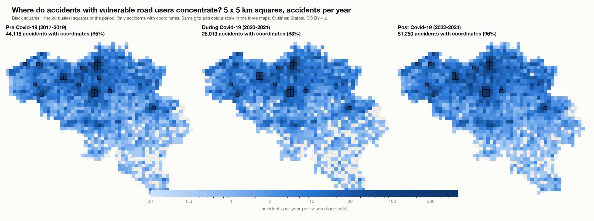
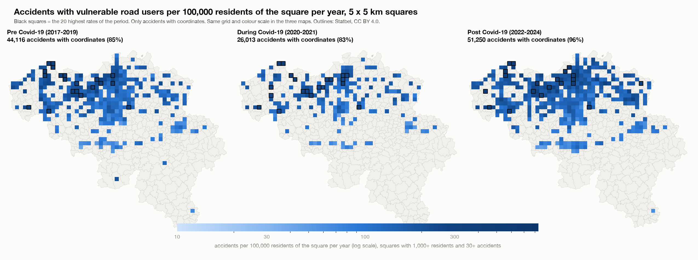
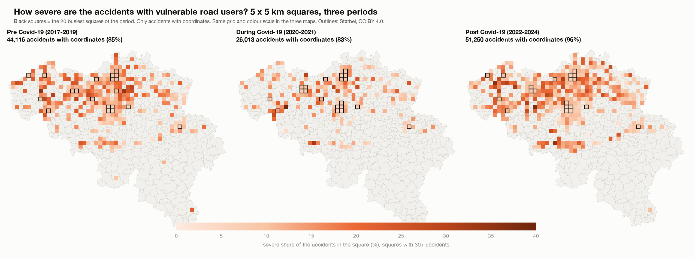
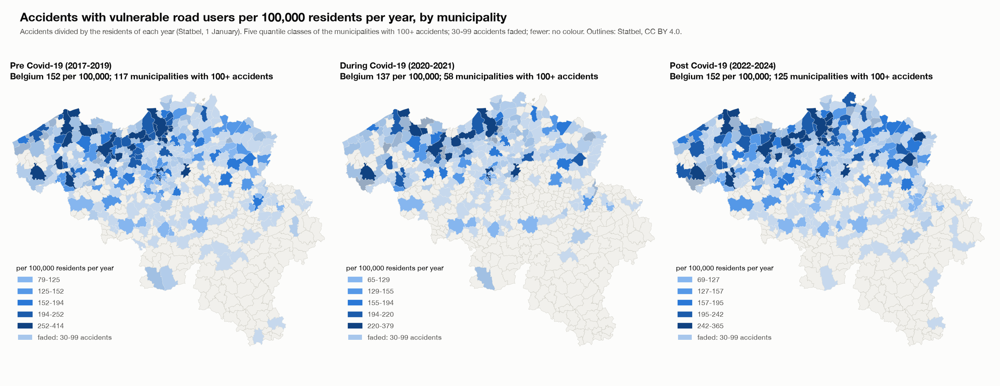

# How the output was calculated: hotspots of accidents with vulnerable road users, before, during and after Covid-19

Report for the hotspot deep dive (`hotspot_deep_dive/`). It explains, in the order of the calculation, where every number in the Streamlit app, the HTML page and the pictures comes from, so that each number can be reproduced and explained. Scripts: `scripts/01` to `scripts/04`. Decisions and their reasons: `beslissingslogboek.md`, entries #169-#186. All numbers in this report are read from the saved tables in `results/` and `data/` by `scripts/04_build_report.py`.

## 1. The question and what was decided

**Question.** Who is involved in accidents, where do accidents with vulnerable road users (pedestrians, cyclists, motorcycles, mopeds) concentrate, did that change before (2017-2019), during (2020-2021) and after (2022-2024) Covid-19, how severe are the accidents at the hotspots, and does the picture change when the number of residents is taken into account?

| Choice | Decision | Entry |
|---|---|---|
| Step 1 | 1a (accidents per road-user group) and 1b (annual change) come first, as in the focused dashboard; no 1c | #181 |
| Grid | Squares of 5 km x 5 km (25 km2), instead of the 500 m squares of the earlier analysis; the 5 km2 cells of the first version were removed | #170, #182 |
| Residents | Rates per municipality and, new, per 5 x 5 km square: accidents per 100,000 residents per year, using the residents of each year | #171, #178, #183 |
| Severity | Severe share (classes 1-3) per square, with fatal and serious shares and 95% intervals in tables | #172 |
| Groups | Pedestrians, cyclists, motorcycles, mopeds, and all four together | #173 |
| Small numbers | No share under 30 accidents; a rate per square needs 1,000 residents and 30 accidents; a municipality rate in full colour from 100 accidents, faded and flagged from 30 to 99 | #175, #177, #184 |

## 2. The data

- **Accidents:** the Belgian road accident open data 2017-2024, translated and flagged in the main project: 289,532 accidents, one row per accident. The severity class belongs to the whole accident.
- **Step 1 (1a, 1b):** the accidents per road-user group, year and month (`data/dashboard_data.csv`, from step 1 of the main project): accidents per group, and the annual change with 2017 = 100. Same numbers and counting rule as in the earlier analysis.
- **Counting rule (#33):** an accident counts for a group if the group is road user 1 or road user 2, once per accident. "All four vulnerable groups" counts an accident that involves two of them once: 136,627 accidents, less than the sum of the four groups.
- **Severity:** *severe* = accident class 1, 2 or 3 (fatal, fatally injured, seriously injured); *fatal* = class 1 or 2; *serious* = class 3 (#116). 28,532 of the 289,532 accidents are severe (9.85%).
- **Coordinates:** the accident file has Belgian Lambert 1972 coordinates (metres). Coordinates outside Belgium's range (two accidents) are treated as missing (#90). Accidents without usable coordinates cannot be put in a grid square.
- **Periods (#38):** pre 2017-2019 (3 years), during 2020-2021 (2 years), post 2022-2024 (3 years), plus all years (8 years). These names are my own definition; the data states no cause. Because the periods have different lengths, counts are divided by the number of years: **accidents per year**.
- **Residents:** Statbel open data (CC BY 4.0): per municipality for each year 2017-2024 (section 6) and per statistical sector for 1 January 2023 (section 4).

### Accidents with usable coordinates

Grid squares use only the accidents that have coordinates. The share without coordinates changes strongly over time, which matters for the comparison of the periods:

| Group | Pre (2017-2019) | During (2020-2021) | Post (2022-2024) |
|---|---|---|---|
| All four vulnerable groups | 51,917 (85.0% with coordinates) | 31,473 (82.7% with coordinates) | 53,237 (96.3% with coordinates) |
| Pedestrians | 12,409 (84.5% with coordinates) | 6,364 (83.5% with coordinates) | 11,124 (95.9% with coordinates) |
| Cyclists | 25,446 (84.9% with coordinates) | 17,265 (82.4% with coordinates) | 29,170 (96.4% with coordinates) |
| Motorcycles | 8,241 (84.2% with coordinates) | 4,375 (80.2% with coordinates) | 7,176 (95.0% with coordinates) |
| Mopeds | 8,689 (86.1% with coordinates) | 5,242 (84.0% with coordinates) | 9,327 (96.8% with coordinates) |

For all four groups together, 15% of the accidents lack coordinates before Covid-19, 17% during it and 3.7% after it. That is why the located accidents per year rise from 14,705 to 17,083 (+16%) while all accidents of the group per year (with or without coordinates) rise only from 17,306 to 17,746 (+2.5%). Grid counts are not corrected for this (#179); the report and the apps say so. Municipality rates use all accidents.

## 3. The grid squares and the hotspots (script `02`, parts A and B)

1. **Squares.** The grid has sides of 5,000 m, aligned to multiples of 5,000 m in Belgian Lambert 1972: the square of an accident is `(floor(x / 5000), floor(y / 5000))`. 1,274 squares contain at least one accident of the four groups.
2. **Counting.** For each group and period: the accidents with coordinates per square, the severe, fatal and serious accidents per square, and accidents per year = accidents / years of the period. The sum over the squares equals the number of located accidents of the group and period (checked in the script).
3. **Hotspots.** The 20 squares with the most accidents (ties: lowest column, then row). The municipality of a hotspot is the most common municipality among its accidents (a square can cover several municipalities).
4. **Severity of the hotspots.** For each group and period the severity of the 20 hotspot squares is compared with all other squares together: severe, fatal and serious shares with 95% Wilson intervals (the same method as step 2 of the main project, #74). A share is only given for 30 or more accidents.
5. **Heat maps.** Accidents per year per square on a **log colour scale** (a few city squares have hundreds of accidents a year, most squares less than one), and the severe share per square on a linear scale from 0 to 40% (squares with 30 or more accidents). In the three-period view the three maps share the same grid and the same colour scale.

The busiest squares for all four groups together (accidents per year):

| Period | 1st | 2nd | 3rd | 4th | 5th |
|---|---|---|---|---|---|
| Pre (2017-2019) | Brussel 634 | Antwerpen 562 | Anderlecht 455 | Elsene 334 | Schaarbeek 325 |
| During (2020-2021) | Brussel 604 | Antwerpen 459 | Brussel 396 | Elsene 288 | Antwerpen 284 |
| Post (2022-2024) | Brussel 656 | Antwerpen 620 | Anderlecht 499 | Antwerpen 386 | Antwerpen 352 |

**Do the hotspots move?** Number of the 20 busiest squares of the pre period that are still among the 20 busiest of the post period:

| Grid | All four vulnerable groups | Pedestrians | Cyclists | Motorcycles | Mopeds |
|---|---|---|---|---|---|
| 5 x 5 km squares | 18 of 20 | 17 of 20 | 19 of 20 | 16 of 20 | 19 of 20 |

## 4. Accidents per 100,000 residents of a square (scripts `01b` and `02`)

The question: busy squares are busy because many people live there. To compare squares fairly the accidents are divided by the residents of the square (decision #183).

1. **Residents per sector.** Statbel publishes the residents on 1 January 2023 for each of the 19,795 statistical sectors (`OPENDATA_SECTOREN_2023`); the sectors are the small areas of the Statbel map of 2023. Statbel adds per municipality one row of residents who cannot be located in a sector (8,046 people, 0.07%); they are spread over the sectors of their municipality in proportion to the sector residents, so that every municipality total stays exact. The residents add up to the Belgian total of 11,697,556 (rounding).
2. **From sectors to squares.** Each sector polygon is cut by the 5 x 5 km grid (the same squares as the accidents) and the residents of the sector are shared over the pieces in proportion to their **area**. This assumes that people are spread evenly inside a sector; sectors are small compared with a 25 km2 square, so the error is small, but a square that holds a large sector with houses on only one side may be off. 1,368 squares contain residents; 1,082 have 1,000 or more; the most populated square (Brussels) has 340,044 residents. A check in the script: the pieces of a sector add up to its area.
3. **From 2023 to every year.** Statbel's sector files exist only for some years (not for 2017 and 2019) and each follows that year's sector boundaries, so one reference year is used (2023, the year of the sector map). For every year the residents of a piece (square x municipality) are multiplied by the growth of its municipality: the residents of that year divided by the residents of 2023 (from the municipality table of section 6). A check in the script: the residents of all squares, added up over all years, equal the residents of all municipalities added up over all years.
4. **The rate.** For a square, group and period: `accidents / resident-years x 100,000`, where resident-years is the sum over the years of the period of the residents of the square in that year. It is the average yearly number of accidents per 100,000 residents of the square.
5. **Small squares (#184).** A rate is shown only for squares with at least 1,000 residents (on average over the period) and at least 30 accidents; otherwise a forest or an industrial square with a few residents would get an extreme rate. 594 of the 1,274 squares with accidents of the four groups (2017-2024) qualify.
6. **Marked squares.** For the rate measure the 20 black squares and the top-20 table are the 20 highest rates among the qualifying squares; for the other measures they are the 20 busiest by number.

The squares with the highest rates (all four groups; rate per 100,000 residents per year, with accidents in the period and average residents):

| Period | 1st | 2nd | 3rd | 4th | 5th |
|---|---|---|---|---|---|
| Pre (2017-2019) | Brugge 439 (32 acc., 2,428 res.) | Eeklo 406 (40 acc., 3,282 res.) | Eeklo 377 (197 acc., 17,416 res.) | Knokke-Heist 366 (236 acc., 21,496 res.) | Gent 351 (769 acc., 73,025 res.) |
| During (2020-2021) | Knokke-Heist 446 (51 acc., 5,721 res.) | Leuven 332 (372 acc., 56,067 res.) | Knokke-Heist 312 (134 acc., 21,462 res.) | Ieper 297 (90 acc., 15,145 res.) | Aartselaar 284 (118 acc., 20,763 res.) |
| Post (2022-2024) | Stabroek 836 (54 acc., 2,154 res.) | Brugge 536 (39 acc., 2,424 res.) | Beveren 530 (39 acc., 2,454 res.) | Evergem 474 (84 acc., 5,905 res.) | Knokke-Heist 389 (66 acc., 5,650 res.) |
| All years (2017-2024) | Stabroek 537 (92 acc., 2,142 res.) | Brugge 459 (89 acc., 2,426 res.) | Knokke-Heist 362 (165 acc., 5,698 res.) | Knokke-Heist 349 (596 acc., 21,376 res.) | Gent 341 (2021 acc., 73,995 res.) |

The busiest squares are not the highest per resident:

| Busiest squares (all four groups, 2017-2024) | Accidents per year | Average residents | Per 100,000 residents per year |
|---|---|---|---|
| Brussel | 635 | 333,386 | 190 |
| Antwerpen | 558 | 180,267 | 310 |
| Anderlecht | 457 | 257,668 | 177 |

Only 7 of the 20 busiest squares (2017-2024) are also among the 20 highest rates (7, 8 and 7 in the pre, during and post period). The highest rates are in squares of 2,000 to 6,000 residents on a through road or in a tourist town, and in Gent and Leuven. Median rate of the qualifying squares: 116 per 100,000 residents per year.

Limits of the rate per square: it counts only accidents with coordinates (89% of all), so it is lower than the municipality rate; people who pass through a square (commuters, visitors) are not residents; and the residents are spread by area inside sectors.

## 5. The severity of the hotspots

Share of the accidents involving vulnerable road users that are severe, in the 20 hotspot squares (the 20 busiest) and in all other squares, with 95% Wilson intervals (all four groups together):

| Period | Accidents in 20 hotspot squares | Severe % hotspots (95% interval) | Accidents in all other squares | Severe % other squares (95% interval) | Fatal % hotspots / others |
|---|---|---|---|---|---|
| Pre (2017-2019) | 14,370 | 8.2% (7.8-8.7) | 29,746 | 15.1% (14.7-15.6) | 0.55% / 1.91% |
| During (2020-2021) | 8,341 | 7.2% (6.6-7.7) | 17,672 | 14.7% (14.2-15.2) | 0.44% / 1.83% |
| Post (2022-2024) | 15,602 | 7.2% (6.8-7.6) | 35,648 | 13.6% (13.2-13.9) | 0.45% / 1.60% |
| All years (2017-2024) | 38,228 | 7.6% (7.4-7.9) | 83,151 | 14.3% (14.1-14.6) | 0.47% / 1.77% |

By group (2017-2024):

| Group | Severe % hotspots | Severe % other squares | Fatal % hotspots | Fatal % other squares |
|---|---|---|---|---|
| All four vulnerable groups | 7.6% | 14.3% | 0.47% | 1.77% |
| Pedestrians | 8.9% | 16.0% | 0.99% | 2.67% |
| Cyclists | 6.9% | 12.9% | 0.30% | 1.18% |
| Motorcycles | 10.0% | 22.9% | 0.80% | 3.53% |
| Mopeds | 6.0% | 9.7% | 0.17% | 0.76% |

Accidents in the hotspots are much less often severe than elsewhere, in every period and for every group. This is an association: hotspots are in cities, where speeds are lower; speed is not in the data.

## 6. The residents per municipality and the rates per municipality (scripts `01` and `02`, part C)

**Where the residents come from.** Statbel publishes the population of each municipality on 1 January of each year (`TF_SOC_POP_STRUCT_<year>`). The file is one row per age, sex, nationality and marital status; the residents of a municipality are the sum of `MS_POPULATION`. Script `01` downloads the files of 2017-2024 and adds them up.

**The 2019 mergers.** On 1 January 2019 several Flemish municipalities merged and got new NIS codes. The 2017 and 2018 files have 589 old codes, the 2019-2024 files and the accident data have the 581 current codes. The Statbel statistical sectors of 2023 carry both codes (the first five characters of `C_NIS6` are the old municipality, `CNIS5_2023` the current one), which gives an exact table old code -> current code (`data/nis_old_to_2023.csv`); the residents of merged municipalities are added up. After this step every year has 581 municipalities and the total equals the Belgian total of that year:

| Year (1 January) | Residents in Belgium (581 municipalities) |
|---|---|
| 2017 | 11,322,088 |
| 2018 | 11,376,070 |
| 2019 | 11,431,406 |
| 2020 | 11,492,641 |
| 2021 | 11,521,238 |
| 2022 | 11,584,008 |
| 2023 | 11,697,557 |
| 2024 | 11,763,650 |

**The rate.** For a municipality, group and period:

`accidents per 100,000 residents per year = accidents / resident-years x 100,000`, where resident-years is the sum over the years of the period of the residents of **that year** (#171). It uses all accidents of the municipality, with or without coordinates.

**Small numbers (#175, #177).** A rate is in full colour and can be ranked from 100 accidents of the group in the period; with 30 to 99 accidents it is shown faded and flagged; under 30 it is not shown. A stricter rule (100 accidents for any display) would leave almost nothing for single groups. Municipalities with 100 or more accidents of the group:

| Group | Pre (2017-2019) | During (2020-2021) | Post (2022-2024) | All years (2017-2024) |
|---|---|---|---|---|
| All four vulnerable groups | 117 | 58 | 125 | 302 |
| Pedestrians | 18 | 8 | 15 | 51 |
| Cyclists | 47 | 25 | 60 | 174 |
| Motorcycles | 8 | 3 | 6 | 19 |
| Mopeds | 12 | 6 | 12 | 42 |

**Results for all four groups together** (rates per 100,000 residents per year; five highest):

| Period | Belgium per 100,000 per year | Municipalities with 100+ accidents | Highest rates (per 100,000 per year) |
|---|---|---|---|
| Pre (2017-2019) | 152.1 | 117 | Brussel 414, Eeklo 410, Wijnegem 397, Knokke-Heist 375, Gent 320 |
| During (2020-2021) | 136.8 | 58 | Knokke-Heist 379, Brussel 369, Leuven 319, Sint-Niklaas 295, Eeklo 294 |
| Post (2022-2024) | 151.9 | 125 | Brussel 365, Knokke-Heist 352, Wommelgem 349, Gent 313, Sint-Niklaas 302 |
| All years (2017-2024) | 148.2 | 302 | Brussel 384, Knokke-Heist 368, Wijnegem 349, Eeklo 321, Wommelgem 306 |

**Why residents matter.** Counts favour big places. 9 of the 20 municipalities with the most accidents (all four groups, 2017-2024) are also among the 20 with the highest rate. Example:

| Municipality (all four groups, 2017-2024) | Accidents | Average residents | Per 100,000 residents per year |
|---|---|---|---|
| Antwerpen | 12,043 | 530,331 | 283.9 |
| Brussel | 5,716 | 186,177 | 383.8 |
| Knokke-Heist | 969 | 32,953 | 367.6 |

Antwerpen has by far the most accidents (first by number) but a rate below Brussel and Knokke-Heist: it has more residents.

## 7. How the pictures, the app and the page are built

- `scripts/03_plot_heatmaps.py` draws `images/*.png` from the saved tables (no recalculation).
- `charts.py` builds the Plotly charts from the saved tables; `app.py` (Streamlit) shows step 1 first and then the hotspot views with filters (view, group, measure, period, rank by).
- `build_html.py` packs the saved tables as compact lists in one HTML file (`hotspot_deep_dive.html`); the page draws step 1, the heat maps and the rate maps in the browser from them, so every combination of buttons works. The severity charts are built in Python and embedded.

## 8. Checks

- The script checks that its totals equal the main project: 289,532 accidents, 28,532 severe accidents, and 29,897 pedestrian, 71,881 cyclist, 19,792 motorcycle and 23,258 moped accidents.
- For every group and period, the square counts add up to the accidents with coordinates, and the municipality counts add up to all accidents of the group.
- The residents of every year add up to the Belgian total for 581 municipalities; the sector residents add up to the Belgian total of 1 January 2023; the pieces of a sector add up to its area; the residents of all squares over all years equal the residents of all municipalities over all years.
- The Streamlit app was run through every view, group, period, measure and ranking without errors. The HTML page was opened in a browser, every button was used, and the tables on the page equal the saved results (for example Brussel 383.8 and Knokke-Heist 367.6 accidents per 100,000 residents per year for all four groups; Stabroek 835.6 per 100,000 residents in the squares of 2022-2024).

## 9. Limits

- **Coordinates:** missing coordinates change over the periods (section 2); grid counts per year are understated before Covid-19. Wallonia has more missing coordinates, so hotspots there may be understated.
- **Residents are not traffic.** Municipalities and squares with visitors, commuters or tourists (Brussel, Knokke-Heist, Gent) get a high rate because many of the people involved do not live there. A rate per resident is not a rate per kilometre travelled.
- **Residents of a square are an estimate:** sector residents of 2023, spread by area and scaled with the growth of the municipality.
- **Hotspots are where accidents are counted.** A different grid origin or size would give different squares.
- **Small municipalities and squares:** a rate or a share moves with a few accidents; this is why minimum numbers are needed.
- **Associations, not causes.** The Covid-19 periods are my own definition; the data states no cause.
