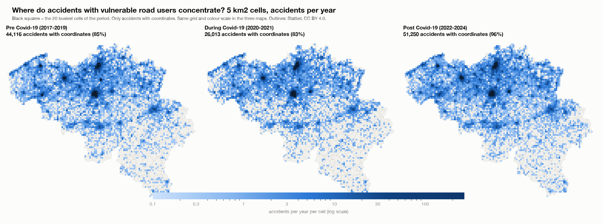
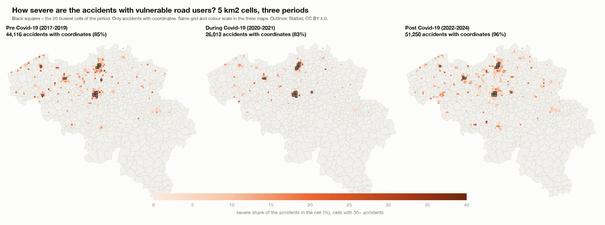
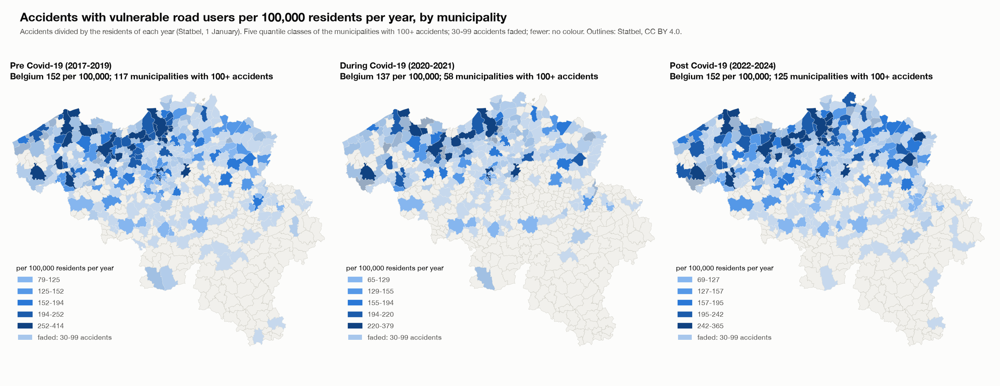

# How the output was calculated: hotspots of accidents with vulnerable road users, before, during and after Covid-19

Report for the hotspot deep dive with step 1 of the focused dashboard added (`hotspot_dive_deep_final/`). It explains, in the order of the calculation, where every number in the Streamlit app, the HTML page and the pictures comes from, so that each number can be reproduced and explained. Scripts: `scripts/01` to `scripts/04`. Decisions and their reasons: `beslissingslogboek.md`, entries #169-#178. All numbers in this report are read from the saved tables in `results/` and `data/` by `scripts/04_build_report.py`.

## 1. The question and what was decided

**Question.** Where do accidents with vulnerable road users (pedestrians, cyclists, motorcycles, mopeds) concentrate, did that change before (2017-2019), during (2020-2021) and after (2022-2024) Covid-19, how severe are the accidents at the hotspots, and does the picture change when the number of residents is taken into account?

| Choice | Decision | Entry |
|---|---|---|
| Step 1 | 1a (accidents per road-user group) and 1b (annual change) of the focused dashboard come first, with their own filters; the rest of the analysis is unchanged | #193-#195 |
| Grid | Two sizes, to compare: cells of 5 km2 in area (side 2,236 m) and squares of 5 km x 5 km (25 km2), instead of the 500 m squares of the earlier analysis | #170 |
| Residents | Rates per municipality: accidents per 100,000 residents per year, with the residents of each year | #171, #178 |
| Severity | Severe share (classes 1-3) per cell, with fatal and serious shares and 95% intervals in tables | #172 |
| Groups | Pedestrians, cyclists, motorcycles, mopeds, and all four together | #173 |
| Small numbers | No share under 30 accidents; a rate in full colour from 100 accidents, faded and flagged from 30 to 99 | #175, #177 |

## 2. The data

- **Accidents:** the Belgian road accident open data 2017-2024, translated and flagged in the main project: 289,532 accidents, one row per accident. The severity class belongs to the whole accident.
- **Counting rule (#33):** an accident counts for a group if the group is road user 1 or road user 2, once per accident. "All four vulnerable groups" counts an accident that involves two of them once: 136,627 accidents, less than the sum of the four groups.
- **Severity:** *severe* = accident class 1, 2 or 3 (fatal, fatally injured, seriously injured); *fatal* = class 1 or 2; *serious* = class 3 (#116). 28,532 of the 289,532 accidents are severe (9.85%).
- **Coordinates:** the accident file has Belgian Lambert 1972 coordinates (metres). Coordinates outside Belgium's range (two accidents) are treated as missing (#90). Accidents without usable coordinates cannot be put in a grid cell.
- **Periods (#38):** pre 2017-2019 (3 years), during 2020-2021 (2 years), post 2022-2024 (3 years), plus all years (8 years). These names are my own definition; the data states no cause. Because the periods have different lengths, cell counts are divided by the number of years: **accidents per year**.
- **Residents:** Statbel open data (CC BY 4.0), "population by place of residence", one file per year, the population on 1 January of 2017 to 2024. See section 6.

### Accidents with usable coordinates

Grid cells use only the accidents that have coordinates. The share without coordinates changes strongly over time, which matters for the comparison of the periods:

| Group | Pre (2017-2019) | During (2020-2021) | Post (2022-2024) |
|---|---|---|---|
| All four vulnerable groups | 51,917 (85.0% with coordinates) | 31,473 (82.7% with coordinates) | 53,237 (96.3% with coordinates) |
| Pedestrians | 12,409 (84.5% with coordinates) | 6,364 (83.5% with coordinates) | 11,124 (95.9% with coordinates) |
| Cyclists | 25,446 (84.9% with coordinates) | 17,265 (82.4% with coordinates) | 29,170 (96.4% with coordinates) |
| Motorcycles | 8,241 (84.2% with coordinates) | 4,375 (80.2% with coordinates) | 7,176 (95.0% with coordinates) |
| Mopeds | 8,689 (86.1% with coordinates) | 5,242 (84.0% with coordinates) | 9,327 (96.8% with coordinates) |

For all four groups together, 15% of the accidents lack coordinates before Covid-19, 17% during it and 3.7% after it. That is why the located accidents per year rise from 14,705 to 17,083 (+16%) while all accidents of the group per year (with or without coordinates) rise only from 17,306 to 17,746 (+2.5%). Grid counts are not corrected for this; the report and the apps say so. Municipality rates use all accidents.

## 3. Step 1: who is involved, and the annual change (1a, 1b)

This step is taken unchanged from the focused dashboard and comes first. **What was calculated.** For every road-user group, the accidents in which the group is involved in 2017-2024 and their share of all 289,532 accidents (1a); and the accidents per year with 2017 = 100, the change of 2020 against 2019, and the change of the average per year in 2022-2024 against 2017-2019 (1b). The numbers come from the summary table `data/dashboard_data.csv` (accidents per group, year and month), calculated in the main project with the counting rule of section 2. "Unknown" and "Other road user" are separate lines.

| Road-user group | Accidents 2017-2024 | % of all accidents | 2020 against 2019 | Index 2024 (2017 = 100) | Post against pre (average per year) |
|---|---|---|---|---|---|
| Passenger car | 203,159 | 70.2% | -25.0% | 82 | -12.2% |
| Bicycle | 71,881 | 24.8% | -5.5% | 115 | +14.6% |
| Unknown | 31,086 | 10.7% | 0.4% | 213 | +65.3% |
| Pedestrian | 29,897 | 10.3% | -30.4% | 86 | -10.4% |
| Van / light truck | 23,557 | 8.1% | -14.8% | 97 | +1.5% |
| Moped | 23,258 | 8.0% | -20.9% | 105 | +7.3% |
| Motorcycle | 19,792 | 6.8% | -18.6% | 83 | -12.9% |
| Truck | 12,595 | 4.4% | -19.9% | 73 | -17.2% |
| Other road user | 6,356 | 2.2% | -26.1% | 127 | +20.9% |
| Bus | 4,095 | 1.4% | -37.7% | 97 | -6.4% |

**How to read it.** The shares add up to more than 100% because one accident can involve two groups. These are counts: a group that is common on the road (cars, bicycles) appears often for that reason alone; severity and traffic volume are not in this step. Nearly every group drops in 2020, the year of the lockdowns; by 2024 bicycles and mopeds are above the level of 2017 and cars, trucks, motorcycles and pedestrians below it. The pre, during and post periods are my own names. "Unknown" more than doubles from 2017 to 2024, so part of the decline of the named groups may be recording that shifts into "Unknown". The filters of this step (years, road-user groups) are on the page and in the app; the hotspot sections that follow have their own filters.

## 4. The grid cells and the hotspots (script `02`, parts A and B)

1. **Cell size.** A cell of 5 km2 has a side of sqrt(5) x 1,000 = 2,236.07 m; the other grid has sides of 5,000 m. Both are aligned to multiples of the side in Belgian Lambert 1972: the cell of an accident is `(floor(x / side), floor(y / side))`. 5,013 5 km2 cells and 1,274 5 x 5 km squares contain at least one accident of the four groups.
2. **Counting.** For each size, group and period: the accidents with coordinates per cell, the severe, fatal and serious accidents per cell, and accidents per year = accidents / years of the period. The sum over the cells equals the number of located accidents of the group and period (checked in the script).
3. **Hotspots.** The 20 cells with the most accidents (ties: lowest column, then row). The municipality of a hotspot is the most common municipality among its accidents (a cell can cover several municipalities).
4. **Severity of the hotspots.** For each group, period and size the severity of the 20 hotspot cells is compared with all other cells together: severe, fatal and serious shares with 95% Wilson intervals (the same method as step 2 of the main project, #74). A share is only given for 30 or more accidents.
5. **Heat maps.** Accidents per year per cell on a **log colour scale** (a few city cells have hundreds of accidents a year, most cells less than one), and the severe share per cell on a linear scale from 0 to 40% (cells with 30 or more accidents). In the three-period view the three maps share the same grid and the same colour scale.

The busiest cells for all four groups together (accidents per year; 5 km2 cells and 5 x 5 km squares):

| Cell size | Period | 1st | 2nd | 3rd | 4th | 5th |
|---|---|---|---|---|---|---|
| 5 km2 cells | Pre (2017-2019) | Brussel 264 | Antwerpen 246 | Sint-Gillis 210 | Elsene 176 | Brussel 168 |
| 5 km2 cells | During (2020-2021) | Brussel 252 | Brussel 188 | Antwerpen 188 | Elsene 156 | Brussel 136 |
| 5 km2 cells | Post (2022-2024) | Antwerpen 269 | Brussel 268 | Sint-Gillis 219 | Elsene 158 | Antwerpen 158 |
| 5 x 5 km squares | Pre (2017-2019) | Brussel 634 | Antwerpen 562 | Anderlecht 455 | Elsene 334 | Schaarbeek 325 |
| 5 x 5 km squares | During (2020-2021) | Brussel 604 | Antwerpen 459 | Brussel 396 | Elsene 288 | Antwerpen 284 |
| 5 x 5 km squares | Post (2022-2024) | Brussel 656 | Antwerpen 620 | Anderlecht 499 | Antwerpen 386 | Antwerpen 352 |

**Do the hotspots move?** Number of the 20 busiest cells of the pre period that are still among the 20 busiest of the post period:

| Cell size | All four vulnerable groups | Pedestrians | Cyclists | Motorcycles | Mopeds |
|---|---|---|---|---|---|
| 5 km2 cells | 17 of 20 | 18 of 20 | 19 of 20 | 15 of 20 | 12 of 20 |
| 5 x 5 km squares | 18 of 20 | 17 of 20 | 19 of 20 | 16 of 20 | 19 of 20 |

## 5. The severity of the hotspots

Share of the accidents involving vulnerable road users that are severe, in the 20 hotspot cells and in all other cells, with 95% Wilson intervals (all four groups together):

| Cell size | Period | Accidents in 20 hotspot cells | Severe % hotspots (95% interval) | Accidents in all other cells | Severe % other cells (95% interval) | Fatal % hotspots / others |
|---|---|---|---|---|---|---|
| 5 km2 cells | Pre (2017-2019) | 7,824 | 7.3% (6.7-7.9) | 36,292 | 14.1% (13.7-14.5) | 0.45% / 1.68% |
| 5 km2 cells | During (2020-2021) | 4,635 | 5.7% (5.0-6.4) | 21,378 | 13.7% (13.3-14.2) | 0.28% / 1.63% |
| 5 km2 cells | Post (2022-2024) | 8,376 | 6.1% (5.6-6.6) | 42,874 | 12.7% (12.4-13.0) | 0.36% / 1.43% |
| 5 km2 cells | All years (2017-2024) | 20,733 | 6.4% (6.1-6.8) | 100,646 | 13.4% (13.2-13.6) | 0.40% / 1.56% |
| 5 x 5 km squares | Pre (2017-2019) | 14,370 | 8.2% (7.8-8.7) | 29,746 | 15.1% (14.7-15.6) | 0.55% / 1.91% |
| 5 x 5 km squares | During (2020-2021) | 8,341 | 7.2% (6.6-7.7) | 17,672 | 14.7% (14.2-15.2) | 0.44% / 1.83% |
| 5 x 5 km squares | Post (2022-2024) | 15,602 | 7.2% (6.8-7.6) | 35,648 | 13.6% (13.2-13.9) | 0.45% / 1.60% |
| 5 x 5 km squares | All years (2017-2024) | 38,228 | 7.6% (7.4-7.9) | 83,151 | 14.3% (14.1-14.6) | 0.47% / 1.77% |

By group (5 km2 cells, 2017-2024):

| Group | Severe % hotspots | Severe % other cells | Fatal % hotspots | Fatal % other cells |
|---|---|---|---|---|
| All four vulnerable groups | 6.4% | 13.4% | 0.40% | 1.56% |
| Pedestrians | 7.6% | 14.9% | 0.68% | 2.41% |
| Cyclists | 6.1% | 12.0% | 0.23% | 1.03% |
| Motorcycles | 7.0% | 21.7% | 0.42% | 3.22% |
| Mopeds | 5.5% | 9.2% | 0.19% | 0.65% |

Accidents in the hotspots are much less often severe than elsewhere, in every period and for every group. This is an association: hotspots are in cities, where speeds are lower; speed is not in the data.

## 6. The residents and the rates per municipality (scripts `01` and `02`, part C)

**Where the residents come from.** Statbel publishes the population of each municipality on 1 January of each year (`TF_SOC_POP_STRUCT_<year>`). The file is one row per age, sex, nationality and marital status; the residents of a municipality are the sum of `MS_POPULATION`. Script `01` downloads the files of 2017-2024 and adds them up.

**The 2019 mergers.** On 1 January 2019 several Flemish municipalities merged and got new NIS codes. The 2017 and 2018 files have 589 old codes, the 2019-2024 files and the accident data have the 581 current codes. The Statbel statistical sectors of 2023 carry both codes (the first five characters of `C_NIS6` are the old municipality, `CNIS5_2023` the current one), which gives an exact table old code -> current code (`data/nis_old_to_2023.csv`); the residents of merged municipalities are added up. After this step every year has 581 municipalities and the total equals the Belgian total of that year:

| Year (1 January) | Residents in Belgium (581 municipalities) |
|---|---|
| 2017 | 11,322,088 |
| 2018 | 11,376,070 |
| 2019 | 11,431,406 |
| 2020 | 11,492,641 |
| 2021 | 11,521,238 |
| 2022 | 11,584,008 |
| 2023 | 11,697,557 |
| 2024 | 11,763,650 |

**The rate.** For a municipality, group and period:

`accidents per 100,000 residents per year = accidents / resident-years x 100,000`, where resident-years is the sum over the years of the period of the residents of **that year** (#171). It is the average yearly number of accidents per 100,000 residents. It uses all accidents of the municipality, with or without coordinates.

**Small numbers (#175, #177).** A rate is in full colour and can be ranked from 100 accidents of the group in the period; with 30 to 99 accidents it is shown faded and flagged; under 30 it is not shown. A stricter rule (100 accidents for any display) would leave almost nothing for single groups. Municipalities with 100 or more accidents of the group:

| Group | Pre (2017-2019) | During (2020-2021) | Post (2022-2024) | All years (2017-2024) |
|---|---|---|---|---|
| All four vulnerable groups | 117 | 58 | 125 | 302 |
| Pedestrians | 18 | 8 | 15 | 51 |
| Cyclists | 47 | 25 | 60 | 174 |
| Motorcycles | 8 | 3 | 6 | 19 |
| Mopeds | 12 | 6 | 12 | 42 |

**Results for all four groups together** (rates per 100,000 residents per year; five highest):

| Period | Belgium per 100,000 per year | Municipalities with 100+ accidents | Highest rates (per 100,000 per year) |
|---|---|---|---|
| Pre (2017-2019) | 152.1 | 117 | Brussel 414, Eeklo 410, Wijnegem 397, Knokke-Heist 375, Gent 320 |
| During (2020-2021) | 136.8 | 58 | Knokke-Heist 379, Brussel 369, Leuven 319, Sint-Niklaas 295, Eeklo 294 |
| Post (2022-2024) | 151.9 | 125 | Brussel 365, Knokke-Heist 352, Wommelgem 349, Gent 313, Sint-Niklaas 302 |
| All years (2017-2024) | 148.2 | 302 | Brussel 384, Knokke-Heist 368, Wijnegem 349, Eeklo 321, Wommelgem 306 |

**Why residents matter.** Counts favour big places. 9 of the 20 municipalities with the most accidents (all four groups, 2017-2024) are also among the 20 with the highest rate. Example:

| Municipality (all four groups, 2017-2024) | Accidents | Average residents | Per 100,000 residents per year |
|---|---|---|---|
| Antwerpen | 12,043 | 530,331 | 283.9 |
| Brussel | 5,716 | 186,177 | 383.8 |
| Knokke-Heist | 969 | 32,953 | 367.6 |

Antwerpen has by far the most accidents (first by number) but a rate below Brussel and Knokke-Heist: it has more residents.

## 7. How the pictures, the app and the page are built

- `scripts/03_plot_heatmaps.py` draws `images/*.png` from the saved tables (no recalculation).
- `charts.py` and `step1_charts.py` build the Plotly charts from the saved tables; `app.py` (Streamlit) shows step 1 first and then the hotspot views, with filters (view, group, cell size, measure, period, rank by).
- `build_html.py` packs the saved tables as compact lists in one HTML file (`hotspot_deep_dive.html`); the page draws the heat maps and rate maps in the browser from them, so every combination of buttons works. The severity charts are built in Python and embedded.

## 8. Checks

- The script checks that its totals equal the main project: 289,532 accidents, 28,532 severe accidents, and 29,897 pedestrian, 71,881 cyclist, 19,792 motorcycle and 23,258 moped accidents.
- For every group, period and cell size, the cell counts add up to the accidents with coordinates; for every group and period, the municipality counts add up to all accidents of the group.
- The residents of every year add up to the Belgian total for 581 municipalities; the HTML build checks that the resident-years of 2017-2024 equal the sum of the saved resident table.
- The step 1 table adds up to 289,532 accidents (checked in the script). The Streamlit app was run through every view, group, period, cell size and measure without errors. The HTML page was opened in a browser, every button was used, and the tables on the page equal the saved results (for example Brussel 383.8 and Knokke-Heist 367.6 accidents per 100,000 residents per year for all four groups).

## 9. Limits

- **Coordinates:** missing coordinates change over the periods (section 2); grid counts per year are understated before Covid-19. Wallonia has more missing coordinates, so hotspots there may be understated.
- **Residents are not traffic.** Municipalities with visitors, commuters or tourists (Brussel, Knokke-Heist, Gent) get a high rate because many of the people involved do not live there. A rate per resident is not a rate per kilometre travelled.
- **Hotspots are where accidents are counted.** A different grid size or origin would give different cells; the two sizes show the same big picture.
- **Small municipalities:** a rate or a share moves with a few accidents; this is why 100 accidents are needed for full colour.
- **Associations, not causes.** The Covid-19 periods are my own definition; the data states no cause.
