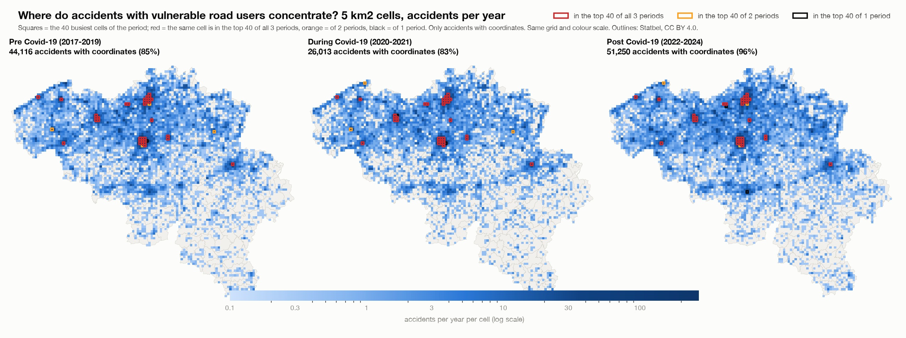
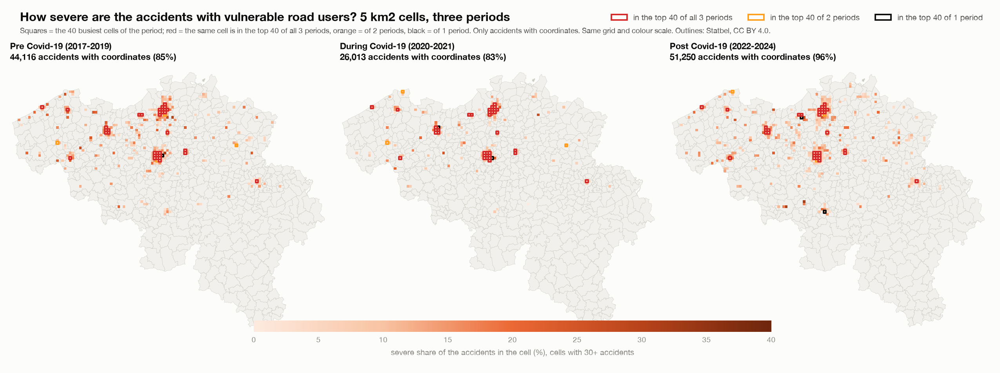
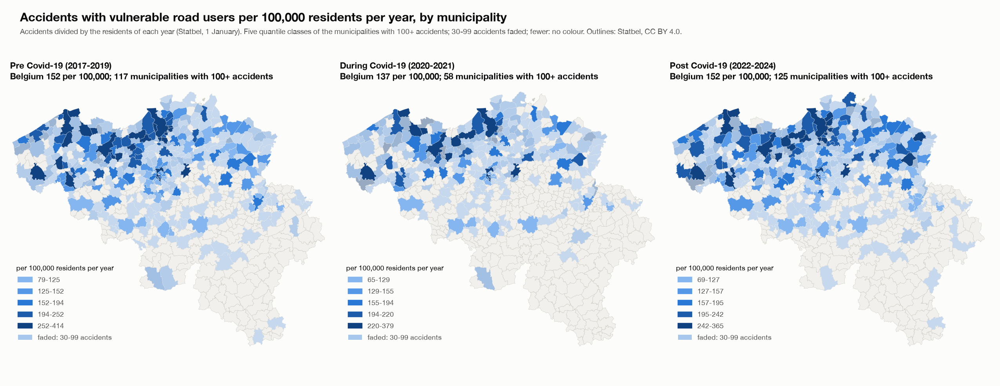

# How the output was calculated: analysis of accident hotspots for vulnerable road users

Report for the analysis of accident hotspots for vulnerable road users with step 1 of the focused dashboard added (`hotspot_dive_deep_osm_4steps/`). It explains, in the order of the calculation, where every number in the Streamlit app, the HTML page and the pictures comes from, so that each number can be reproduced and explained. Scripts: `scripts/01` to `scripts/05`. Decisions and their reasons: `beslissingslogboek.md`, entries #169-#178 and #205-#209 (the regression). All numbers in this report are read from the saved tables in `results/` and `data/` by `scripts/04_build_report.py`.

## 1. The question and what was decided

**Topic.** Spatial and temporal patterns of road traffic accidents involving vulnerable road users in Belgium: A comparative analysis of accident hotspots, severity and municipalities

**Research question (RQ).** Are accidents occurring in identified hotspots more or less likely to result in fatal or serious injuries compared with accidents occurring elsewhere, after accounting for relevant environmental and road conditions?

**Four steps (#227).** In this folder the former step 2 (the single-period heat map with 'All years' and the table of the busiest squares) was removed, because step 3 shows the same maps for the three periods side by side. The steps are numbered 1, 2 (the three maps), 3 (severity, with the regression 3b) and 4 (residents); the numbers inside this report's section titles (sections 4 to 6) still follow the calculation order of the scripts, not the steps. The grid and hotspot calculation of script `02` is unchanged.

**Map version.** In this folder the three maps of step 2 in the app and on the HTML page are drawn on OpenStreetMap (script 06 converts the square corners to longitude and latitude; the numbers are unchanged). The pictures in `images/` (script 03, used in the report) are still the plain grid maps without OpenStreetMap, because a printed picture cannot load map tiles from the internet.

**Descriptive questions behind it.** Where do accidents with vulnerable road users (pedestrians, cyclists, motorcycles, mopeds) concentrate, did that change before (2017-2019), during (2020-2021) and after (2022-2024) Covid-19, how severe are the accidents at the hotspots, and does the picture change when the number of residents is taken into account?

| Choice | Decision | Entry |
|---|---|---|
| Step 1 | 1a (accidents per road-user group) and 1b (annual change) of the focused dashboard come first, with their own filters; the rest of the analysis is unchanged | #193-#195 |
| Grid | Two sizes, to compare: cells of 5 km2 in area (side 2,236 m) and squares of 5 km x 5 km (25 km2), instead of the 500 m squares of the earlier analysis | #170 |
| App and page (later changes) | Only the 5 x 5 km squares are shown (the scripts and this report keep both sizes); a Hotspots filter top 20 / top 40 in steps 2 and 3 and the regression; bar charts of the rankings in step 2; persistence colours in step 2; the step 4 map follows the Rank by filter; the regression separates three kinds of night and has a road-surface term | #213-#218 |
| Residents | Rates per municipality: accidents per 100,000 residents per year, with the residents of each year | #171, #178 |
| Severity | Severe share (classes 1-3) per cell, with fatal and serious shares and 95% intervals in tables | #172 |
| Groups | Pedestrians, cyclists, motorcycles, mopeds, and all four together | #173 |
| Small numbers | No share under 30 accidents; a rate in full colour from 100 accidents, faded and flagged from 30 to 99 | #175, #177 |

## 2. The data

- **Accidents:** the Belgian road accident open data 2017-2024, translated and flagged in the main project: 289,532 accidents, one row per accident. The severity class belongs to the whole accident.
- **Counting rule (#33):** an accident counts for a group if the group is road user 1 or road user 2, once per accident. "All four vulnerable groups" counts an accident that involves two of them once: 136,627 accidents, less than the sum of the four groups.
- **Severity:** *severe* = accident class 1, 2 or 3 (fatal, fatally injured, seriously injured); *fatal* = class 1 or 2; *serious* = class 3 (#116). 28,532 of the 289,532 accidents are severe (9.85%).
- **Coordinates:** the accident file has Belgian Lambert 1972 coordinates (metres). Coordinates outside Belgium's range (two accidents) are treated as missing (#90). Accidents without usable coordinates cannot be put in a grid cell.
- **Periods (#38):** pre 2017-2019 (3 years), during 2020-2021 (2 years), post 2022-2024 (3 years), plus all years (8 years). These names are my own definition; the data states no cause. Because the periods have different lengths, cell counts are divided by the number of years: **accidents per year**.
- **Residents:** Statbel open data (CC BY 4.0), "population by place of residence", one file per year, the population on 1 January of 2017 to 2024. See section 6.

### Accidents with usable coordinates

Grid cells use only the accidents that have coordinates. The share without coordinates changes strongly over time, which matters for the comparison of the periods:

| Group | Pre (2017-2019) | During (2020-2021) | Post (2022-2024) |
|---|---|---|---|
| All four vulnerable groups | 51,917 (85.0% with coordinates) | 31,473 (82.7% with coordinates) | 53,237 (96.3% with coordinates) |
| Pedestrians | 12,409 (84.5% with coordinates) | 6,364 (83.5% with coordinates) | 11,124 (95.9% with coordinates) |
| Cyclists | 25,446 (84.9% with coordinates) | 17,265 (82.4% with coordinates) | 29,170 (96.4% with coordinates) |
| Motorcycles | 8,241 (84.2% with coordinates) | 4,375 (80.2% with coordinates) | 7,176 (95.0% with coordinates) |
| Mopeds | 8,689 (86.1% with coordinates) | 5,242 (84.0% with coordinates) | 9,327 (96.8% with coordinates) |

For all four groups together, 15% of the accidents lack coordinates before Covid-19, 17% during it and 3.7% after it. That is why the located accidents per year rise from 14,705 to 17,083 (+16%) while all accidents of the group per year (with or without coordinates) rise only from 17,306 to 17,746 (+2.5%). Grid counts are not corrected for this; the report and the apps say so. Municipality rates use all accidents.

## 3. Step 1: who is involved, and the annual change (1a, 1b)

This step is taken unchanged from the focused dashboard and comes first. **What was calculated.** For every road-user group, the accidents in which the group is involved in 2017-2024 and their share of all 289,532 accidents (1a); and the accidents per year with 2017 = 100, the change of 2020 against 2019, and the change of the average per year in 2022-2024 against 2017-2019 (1b). The numbers come from the summary table `data/dashboard_data.csv` (accidents per group, year and month), calculated in the main project with the counting rule of section 2. "Unknown" and "Other road user" are separate lines.

| Road-user group | Accidents 2017-2024 | % of all accidents | 2020 against 2019 | Index 2024 (2017 = 100) | Post against pre (average per year) |
|---|---|---|---|---|---|
| Passenger car | 203,159 | 70.2% | -25.0% | 82 | -12.2% |
| Bicycle | 71,881 | 24.8% | -5.5% | 115 | +14.6% |
| Unknown | 31,086 | 10.7% | 0.4% | 213 | +65.3% |
| Pedestrian | 29,897 | 10.3% | -30.4% | 86 | -10.4% |
| Van / light truck | 23,557 | 8.1% | -14.8% | 97 | +1.5% |
| Moped | 23,258 | 8.0% | -20.9% | 105 | +7.3% |
| Motorcycle | 19,792 | 6.8% | -18.6% | 83 | -12.9% |
| Truck | 12,595 | 4.4% | -19.9% | 73 | -17.2% |
| Other road user | 6,356 | 2.2% | -26.1% | 127 | +20.9% |
| Bus | 4,095 | 1.4% | -37.7% | 97 | -6.4% |

**How to read it.** The shares add up to more than 100% because one accident can involve two groups. These are counts: a group that is common on the road (cars, bicycles) appears often for that reason alone; severity and traffic volume are not in this step. Nearly every group drops in 2020, the year of the lockdowns; by 2024 bicycles and mopeds are above the level of 2017 and cars, trucks, motorcycles and pedestrians below it. The pre, during and post periods are my own names. "Unknown" more than doubles from 2017 to 2024, so part of the decline of the named groups may be recording that shifts into "Unknown". The filters of this step (years, road-user groups) are on the page and in the app; the hotspot sections that follow have their own filters.

## 4. The grid cells and the hotspots (script `02`, parts A and B)

1. **Cell size.** A cell of 5 km2 has a side of sqrt(5) x 1,000 = 2,236.07 m; the other grid has sides of 5,000 m. Both are aligned to multiples of the side in Belgian Lambert 1972: the cell of an accident is `(floor(x / side), floor(y / side))`. 5,013 5 km2 cells and 1,274 5 x 5 km squares contain at least one accident of the four groups.
2. **Counting.** For each size, group and period: the accidents with coordinates per cell, the severe, fatal and serious accidents per cell, and accidents per year = accidents / years of the period. The sum over the cells equals the number of located accidents of the group and period (checked in the script).
3. **Hotspots.** The 40 cells with the most accidents (ties: lowest column, then row). The municipality of a hotspot is the most common municipality among its accidents (a cell can cover several municipalities).
4. **Severity of the hotspots.** For each group, period and size the severity of the 40 hotspot cells is compared with all other cells together: severe, fatal and serious shares with 95% Wilson intervals (the same method as step 2 of the main project, #74). A share is only given for 30 or more accidents.
5. **Heat maps.** Accidents per year per cell on a **log colour scale** (a few city cells have hundreds of accidents a year, most cells less than one), and the severe share per cell on a linear scale from 0 to 40% (cells with 30 or more accidents). In the three-period view the three maps share the same grid and the same colour scale.

The busiest cells for all four groups together (accidents per year; 5 km2 cells and 5 x 5 km squares):

| Cell size | Period | 1st | 2nd | 3rd | 4th | 5th |
|---|---|---|---|---|---|---|
| 5 km2 cells | Pre (2017-2019) | Brussel 264 | Antwerpen 246 | Sint-Gillis 210 | Elsene 176 | Brussel 168 |
| 5 km2 cells | During (2020-2021) | Brussel 252 | Brussel 188 | Antwerpen 188 | Elsene 156 | Brussel 136 |
| 5 km2 cells | Post (2022-2024) | Antwerpen 269 | Brussel 268 | Sint-Gillis 219 | Elsene 158 | Antwerpen 158 |
| 5 x 5 km squares | Pre (2017-2019) | Brussel 634 | Antwerpen 562 | Anderlecht 455 | Elsene 334 | Schaarbeek 325 |
| 5 x 5 km squares | During (2020-2021) | Brussel 604 | Antwerpen 459 | Brussel 396 | Elsene 288 | Antwerpen 284 |
| 5 x 5 km squares | Post (2022-2024) | Brussel 656 | Antwerpen 620 | Anderlecht 499 | Antwerpen 386 | Antwerpen 352 |

**Do the hotspots move?** In the three-period heat maps the 40 marked cells of each period are drawn in a colour that shows how persistent the cell is: **red** = the same cell is among the 40 busiest in all three periods, **orange** = in two periods, **black** = in one period (#203). The same colours are used in the single-period heat map (where a gray square would be a cell that is in no period's top 20, possible in the all-years view only). Number of the 40 busiest cells of the pre period that are still among the 40 busiest of the post period:

| Cell size | All four vulnerable groups | Pedestrians | Cyclists | Motorcycles | Mopeds |
|---|---|---|---|---|---|
| 5 km2 cells | 37 of 40 | 34 of 40 | 36 of 40 | 32 of 40 | 33 of 40 |
| 5 x 5 km squares | 34 of 40 | 38 of 40 | 37 of 40 | 30 of 40 | 32 of 40 |

## 5. The severity of the hotspots

Share of the accidents involving vulnerable road users that are severe, in the 40 hotspot cells and in all other cells, with 95% Wilson intervals (all four groups together):

| Cell size | Period | Accidents in 40 hotspot cells | Severe % hotspots (95% interval) | Accidents in all other cells | Severe % other cells (95% interval) | Fatal % hotspots / others |
|---|---|---|---|---|---|---|
| 5 km2 cells | Pre (2017-2019) | 11,544 | 7.7% (7.2-8.2) | 32,572 | 14.7% (14.3-15.1) | 0.46% / 1.82% |
| 5 km2 cells | During (2020-2021) | 6,768 | 6.5% (5.9-7.1) | 19,245 | 14.3% (13.8-14.8) | 0.38% / 1.74% |
| 5 km2 cells | Post (2022-2024) | 12,380 | 6.8% (6.4-7.3) | 38,870 | 13.2% (12.8-13.5) | 0.40% / 1.52% |
| 5 km2 cells | All years (2017-2024) | 30,597 | 7.1% (6.8-7.4) | 90,782 | 14.0% (13.7-14.2) | 0.42% / 1.68% |
| 5 x 5 km squares | Pre (2017-2019) | 18,895 | 9.0% (8.6-9.4) | 25,221 | 15.8% (15.3-16.2) | 0.62% / 2.10% |
| 5 x 5 km squares | During (2020-2021) | 10,925 | 7.9% (7.4-8.4) | 15,088 | 15.4% (14.9-16.0) | 0.52% / 2.02% |
| 5 x 5 km squares | Post (2022-2024) | 20,690 | 7.9% (7.5-8.3) | 30,560 | 14.2% (13.8-14.6) | 0.52% / 1.75% |
| 5 x 5 km squares | All years (2017-2024) | 50,322 | 8.3% (8.1-8.5) | 71,057 | 15.0% (14.8-15.3) | 0.55% / 1.93% |

By group (5 km2 cells, 2017-2024):

| Group | Severe % hotspots | Severe % other cells | Fatal % hotspots | Fatal % other cells |
|---|---|---|---|---|
| All four vulnerable groups | 7.1% | 14.0% | 0.42% | 1.68% |
| Pedestrians | 8.4% | 15.6% | 0.80% | 2.60% |
| Cyclists | 6.5% | 12.5% | 0.28% | 1.11% |
| Motorcycles | 8.5% | 22.3% | 0.63% | 3.36% |
| Mopeds | 5.6% | 9.5% | 0.13% | 0.72% |

Accidents in the hotspots are much less often severe than elsewhere, in every period and for every group. This is an association: hotspots are in cities, where speeds are lower; speed is not in the data.

### 5b. A logistic regression for severity (script `05`)

The comparison above looks at one factor at a time. A **binary logistic regression** looks at several at once: it models the chance that an accident is severe (fatal + serious injury = 1, otherwise 0) and gives, for each explanatory variable, an **odds ratio**: the odds of a severe accident in that category divided by the odds in the reference category, with the other variables held equal. An odds ratio of 1 means no difference; below 1 means less often severe, above 1 more often.

**The model** (one model for the four groups together, 5 x 5 km squares; fitted once with the top 40 and once with the top 20 as the definition of a hotspot, #213):

- **Hotspot:** 1 when the accident is in one of the 40 (or 20) busiest squares of its own group and period (the lists of `results/hotspots_top40.csv`), otherwise 0.
- **Period:** pre Covid-19 (reference), during, post.
- **Group:** cyclists (reference), pedestrians, motorcycles, mopeds. An accident counts in a group when road user 1 or 2 is of that group (#33), so an accident with two groups is a row in both.
- **Built-up area** (extra variable 1): inside (reference) or outside.
- **Light condition** (extra variable 2, changed in #218): daylight (reference), dawn/dusk, and **three kinds of night kept apart**: night with public lighting present and lit (code 3), present but not lit (code 5) and no public lighting (code 4).
- **Road surface** (extra variable 3, added in #218): dry or clean (reference), wet, dirty (sand, gravel, leaves), ice or snow. The raw data also has combinations such as "Wet + Clean"; a combination takes its **worst part** (ice or snow, then wet, then dirty, then dry or clean). Unknown surface is left out.

**The rows.** 119,497 rows (112,994 different accidents), 15,068 severe (12.6%); before road surface was added the model had 124,616 rows. Only accidents with usable coordinates are used (the square must be known), and accidents with unknown built-up area, light condition or road surface are left out:

| Group | Period | Accidents | With coordinates | Used (built-up area, light and road surface known) |
|---|---|---|---|---|
| Bicycle | Pre Covid-19 (2017-2019) | 25,446 | 21,590 | 20,025 |
| Bicycle | During Covid-19 (2020-2021) | 17,265 | 14,219 | 13,242 |
| Bicycle | Post Covid-19 (2022-2024) | 29,170 | 28,129 | 25,636 |
| Pedestrian | Pre Covid-19 (2017-2019) | 12,409 | 10,484 | 9,636 |
| Pedestrian | During Covid-19 (2020-2021) | 6,364 | 5,312 | 4,852 |
| Pedestrian | Post Covid-19 (2022-2024) | 11,124 | 10,667 | 9,570 |
| Motorcycle | Pre Covid-19 (2017-2019) | 8,241 | 6,938 | 6,744 |
| Motorcycle | During Covid-19 (2020-2021) | 4,375 | 3,507 | 3,426 |
| Motorcycle | Post Covid-19 (2022-2024) | 7,176 | 6,820 | 6,567 |
| Moped | Pre Covid-19 (2017-2019) | 8,689 | 7,477 | 7,130 |
| Moped | During Covid-19 (2020-2021) | 5,242 | 4,405 | 4,194 |
| Moped | Post Covid-19 (2022-2024) | 9,327 | 9,032 | 8,475 |

**Estimation.** Maximum likelihood by Newton-Raphson with step-halving (the same code as the main project's `logit_live.py`). Because one accident can be two rows and accidents in one municipality resemble each other, the standard errors are **cluster-robust by municipality** (581 clusters); intervals are coefficient plus or minus 1.96 standard errors, then exponentiated.

| Variable | Term (against the reference) | Odds ratio (top 40) | 95% interval | p value | Odds ratio (top 20) | 95% interval | p value |
|---|---|---|---|---|---|---|---|
| Hotspot | In a hotspot square (top 40 / top 20 of own group and period) | 0.59 | 0.53 to 0.66 | <0.001 | 0.55 | 0.49 to 0.63 | <0.001 |
| Period | During Covid-19 (2020-2021) (against Pre Covid-19) | 0.96 | 0.91 to 1.01 | 0.122 | 0.96 | 0.92 to 1.01 | 0.146 |
| Period | Post Covid-19 (2022-2024) (against Pre Covid-19) | 0.90 | 0.85 to 0.95 | <0.001 | 0.90 | 0.85 to 0.95 | <0.001 |
| Group | Pedestrian (against Bicycle) | 1.40 | 1.30 to 1.51 | <0.001 | 1.41 | 1.31 to 1.51 | <0.001 |
| Group | Motorcycle (against Bicycle) | 1.65 | 1.54 to 1.76 | <0.001 | 1.67 | 1.57 to 1.78 | <0.001 |
| Group | Moped (against Bicycle) | 0.72 | 0.68 to 0.77 | <0.001 | 0.72 | 0.67 to 0.77 | <0.001 |
| Built-up area | Outside built-up area (against inside) | 1.72 | 1.62 to 1.83 | <0.001 | 1.72 | 1.63 to 1.82 | <0.001 |
| Light condition | Dawn, dusk (against daylight) | 0.98 | 0.90 to 1.07 | 0.723 | 0.98 | 0.90 to 1.07 | 0.648 |
| Light condition | Night, public lighting lit (against daylight) | 1.41 | 1.35 to 1.47 | <0.001 | 1.41 | 1.35 to 1.48 | <0.001 |
| Light condition | Night, lighting present but not lit (against daylight) | 1.78 | 1.49 to 2.13 | <0.001 | 1.75 | 1.46 to 2.09 | <0.001 |
| Light condition | Night, no public lighting (against daylight) | 1.63 | 1.42 to 1.86 | <0.001 | 1.64 | 1.44 to 1.88 | <0.001 |
| Road surface | Wet road surface (against dry or clean) | 0.87 | 0.82 to 0.91 | <0.001 | 0.87 | 0.82 to 0.91 | <0.001 |
| Road surface | Dirty road surface (against dry or clean) | 0.70 | 0.56 to 0.87 | 0.001 | 0.70 | 0.57 to 0.87 | 0.001 |
| Road surface | Ice or snow road surface (against dry or clean) | 0.97 | 0.77 to 1.22 | 0.802 | 0.96 | 0.76 to 1.21 | 0.722 |

**The hotspot effect in percentage points.** Setting the hotspot term to 1 and to 0 for every row (all other variables as observed) and averaging the predicted probabilities gives, for the top 40, **9.4%** severe if every accident were in a hotspot square against **14.9%** if none were: **-5.5 points** (95% interval -6.4 to -4.5, from 1,000 simulated coefficient sets). For the top 20: 8.6% against 14.4%, -5.8 points (-6.9 to -4.7).

**Fit.** AUC 0.64, McFadden R2 0.037, highest variance inflation factor 1.25 (no problem with overlap between variables). The model is simple on purpose and only moderately predictive: it describes differences between groups of accidents; it cannot say which single accident will be severe.

**Reading it.** After holding period, group, built-up area, light and road surface equal, accidents in hotspot squares still have clearly lower odds of being severe, so the lower severity in the hotspots is not just that hotspots have more cyclists, more daylight accidents or different road surfaces. Outside built-up areas and at night the odds are higher; compared with daylight the odds are highest where public lighting is present but not lit (that group has only 2,912 accidents, so its interval is wide and it is not shown to differ from "no public lighting"). Wet and dirty roads have lower odds of a severe accident than dry or clean roads, and ice or snow does not differ clearly: these are associations, not proof that those roads are safer (behaviour, speed and exposure are not in the data). An odds ratio is not a risk ratio (13% of the rows are severe), and speed, traffic volume and road layout are not in the data, so this remains an association.

## 6. The residents and the rates per municipality (scripts `01` and `02`, part C)

**Where the residents come from.** Statbel publishes the population of each municipality on 1 January of each year (`TF_SOC_POP_STRUCT_<year>`). The file is one row per age, sex, nationality and marital status; the residents of a municipality are the sum of `MS_POPULATION`. Script `01` downloads the files of 2017-2024 and adds them up.

**The 2019 mergers.** On 1 January 2019 several Flemish municipalities merged and got new NIS codes. The 2017 and 2018 files have 589 old codes, the 2019-2024 files and the accident data have the 581 current codes. The Statbel statistical sectors of 2023 carry both codes (the first five characters of `C_NIS6` are the old municipality, `CNIS5_2023` the current one), which gives an exact table old code -> current code (`data/nis_old_to_2023.csv`); the residents of merged municipalities are added up. After this step every year has 581 municipalities and the total equals the Belgian total of that year:

| Year (1 January) | Residents in Belgium (581 municipalities) |
|---|---|
| 2017 | 11,322,088 |
| 2018 | 11,376,070 |
| 2019 | 11,431,406 |
| 2020 | 11,492,641 |
| 2021 | 11,521,238 |
| 2022 | 11,584,008 |
| 2023 | 11,697,557 |
| 2024 | 11,763,650 |

**The rate.** For a municipality, group and period:

`accidents per 100,000 residents per year = accidents / resident-years x 100,000`, where resident-years is the sum over the years of the period of the residents of **that year** (#171). It is the average yearly number of accidents per 100,000 residents. It uses all accidents of the municipality, with or without coordinates.

**Small numbers (#175, #177).** A rate is in full colour and can be ranked from 100 accidents of the group in the period; with 30 to 99 accidents it is shown faded and flagged; under 30 it is not shown. A stricter rule (100 accidents for any display) would leave almost nothing for single groups. Municipalities with 100 or more accidents of the group:

| Group | Pre (2017-2019) | During (2020-2021) | Post (2022-2024) | All years (2017-2024) |
|---|---|---|---|---|
| All four vulnerable groups | 117 | 58 | 125 | 302 |
| Pedestrians | 18 | 8 | 15 | 51 |
| Cyclists | 47 | 25 | 60 | 174 |
| Motorcycles | 8 | 3 | 6 | 19 |
| Mopeds | 12 | 6 | 12 | 42 |

**Results for all four groups together** (rates per 100,000 residents per year; five highest):

| Period | Belgium per 100,000 per year | Municipalities with 100+ accidents | Highest rates (per 100,000 per year) |
|---|---|---|---|
| Pre (2017-2019) | 152.1 | 117 | Brussel 414, Eeklo 410, Wijnegem 397, Knokke-Heist 375, Gent 320 |
| During (2020-2021) | 136.8 | 58 | Knokke-Heist 379, Brussel 369, Leuven 319, Sint-Niklaas 295, Eeklo 294 |
| Post (2022-2024) | 151.9 | 125 | Brussel 365, Knokke-Heist 352, Wommelgem 349, Gent 313, Sint-Niklaas 302 |
| All years (2017-2024) | 148.2 | 302 | Brussel 384, Knokke-Heist 368, Wijnegem 349, Eeklo 321, Wommelgem 306 |

**Why residents matter.** Counts favour big places. 9 of the 20 municipalities with the most accidents (all four groups, 2017-2024) are also among the 20 with the highest rate. Example:

| Municipality (all four groups, 2017-2024) | Accidents | Average residents | Per 100,000 residents per year |
|---|---|---|---|
| Antwerpen | 12,043 | 530,331 | 283.9 |
| Brussel | 5,716 | 186,177 | 383.8 |
| Knokke-Heist | 969 | 32,953 | 367.6 |

Antwerpen has by far the most accidents (first by number) but a rate below Brussel and Knokke-Heist: it has more residents.

**The severity inside the ranking bars (#226).** In the ranking by rate (step 4), the narrower dark bar inside each bar is the number of severe accidents (fatal + serious injury) of the group in the municipality per 100,000 residents per year, calculated like the rate (severe accidents / resident-years x 100,000) from the saved table `results/municipality_rates.csv`. For all four groups in 2017-2024, Belgium has 18.0 severe accidents per 100,000 residents per year (12.2% of the accidents); only 5 of the 20 municipalities with the highest accident rate are also among the 20 with the highest severe rate (pedestrians 9, cyclists 6, motorcycles 19, mopeds 15). Severe counts per municipality are small, so a severe rate moves a lot with a few accidents.

## 7. How the pictures, the app and the page are built

- `scripts/03_plot_heatmaps.py` draws `images/*.png` from the saved tables (no recalculation).
- `charts.py` and `step1_charts.py` build the Plotly charts from the saved tables; `app.py` (Streamlit) shows step 1 first and then the hotspot views, with filters (view, group, cell size, measure, period, rank by).
- `build_html.py` packs the saved tables as compact lists in one HTML file (`hotspot_deep_dive.html`); the page draws the heat maps and rate maps in the browser from them, so every combination of buttons works. The severity charts are built in Python and embedded.

## 8. Checks

- The script checks that its totals equal the main project: 289,532 accidents, 28,532 severe accidents, and 29,897 pedestrian, 71,881 cyclist, 19,792 motorcycle and 23,258 moped accidents.
- For every group, period and cell size, the cell counts add up to the accidents with coordinates; for every group and period, the municipality counts add up to all accidents of the group.
- The residents of every year add up to the Belgian total for 581 municipalities; the HTML build checks that the resident-years of 2017-2024 equal the sum of the saved resident table.
- The step 1 table adds up to 289,532 accidents (checked in the script). The Streamlit app was run through every view, group, period, cell size and measure without errors. The HTML page was opened in a browser, every button was used, and the tables on the page equal the saved results (for example Brussel 383.8 and Knokke-Heist 367.6 accidents per 100,000 residents per year for all four groups).

## 9. Limits

- **Coordinates:** missing coordinates change over the periods (section 2); grid counts per year are understated before Covid-19. Wallonia has more missing coordinates, so hotspots there may be understated.
- **Residents are not traffic.** Municipalities with visitors, commuters or tourists (Brussel, Knokke-Heist, Gent) get a high rate because many of the people involved do not live there. A rate per resident is not a rate per kilometre travelled.
- **Hotspots are where accidents are counted.** A different grid size or origin would give different cells; the two sizes show the same big picture.
- **Small municipalities:** a rate or a share moves with a few accidents; this is why 100 accidents are needed for full colour.
- **Associations, not causes.** The Covid-19 periods are my own definition; the data states no cause.
