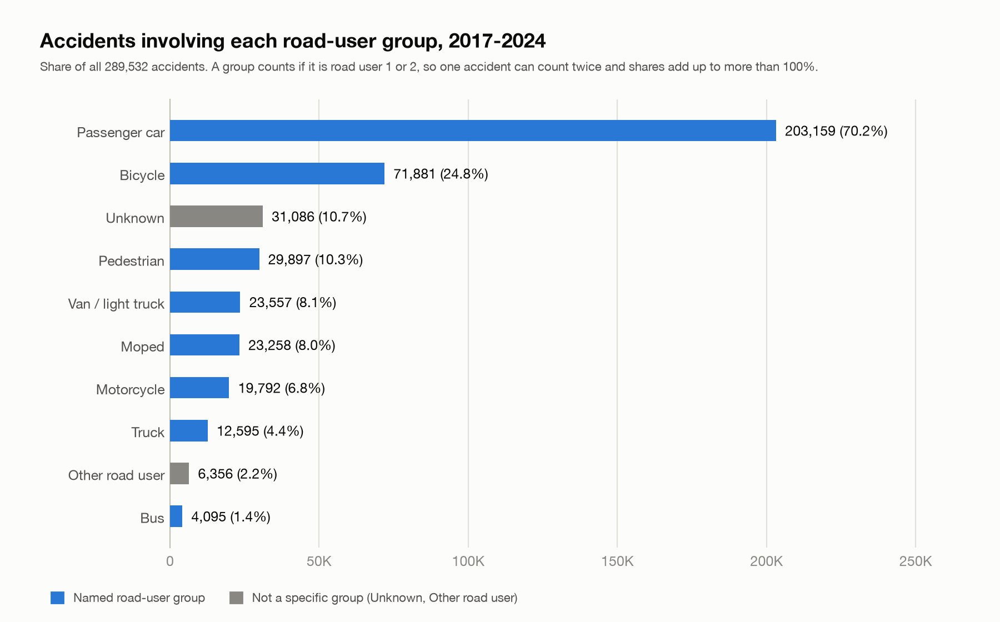
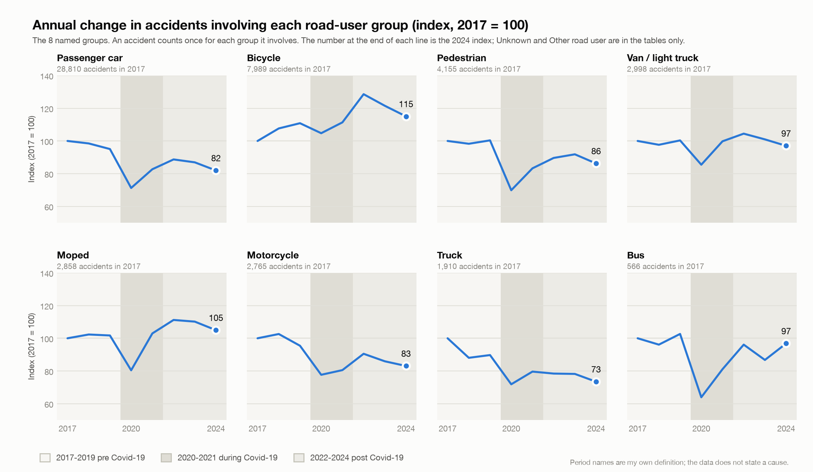
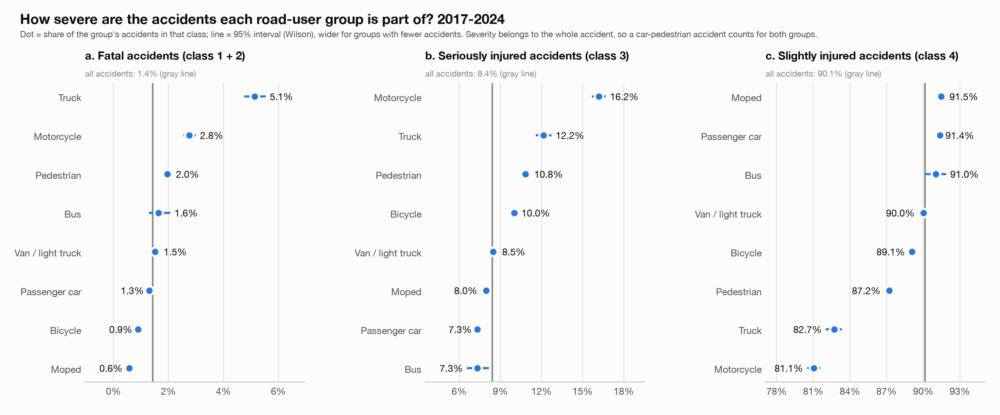
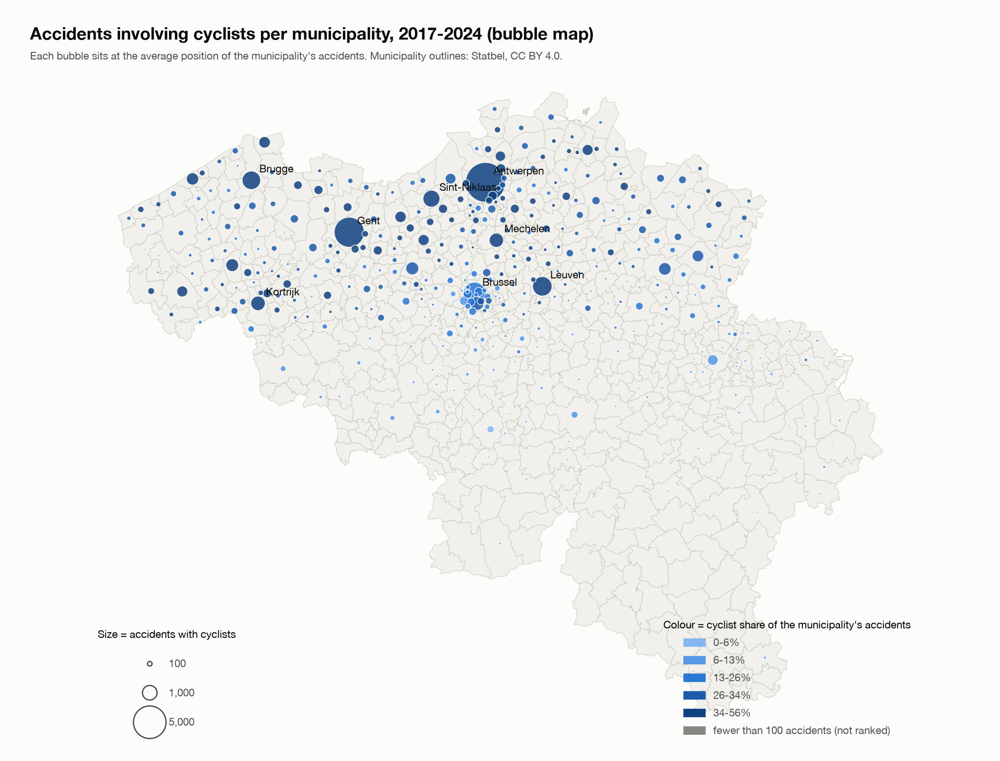
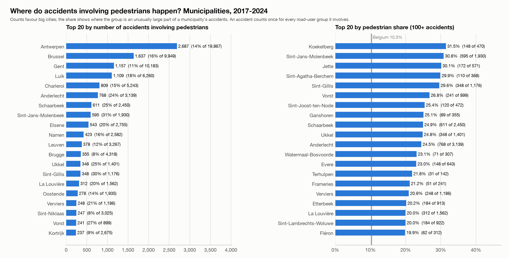
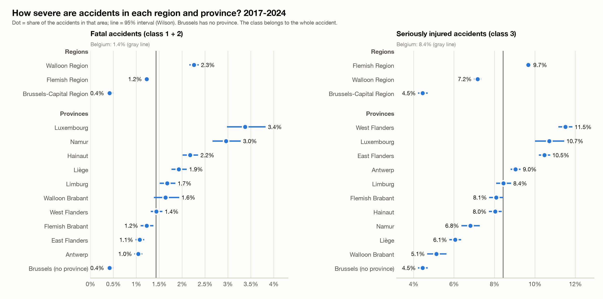
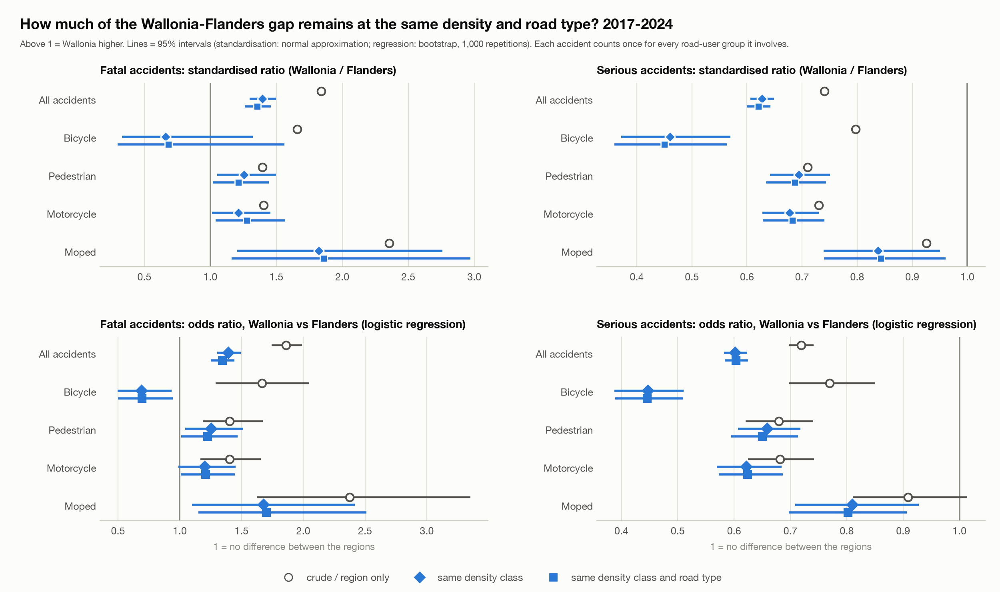
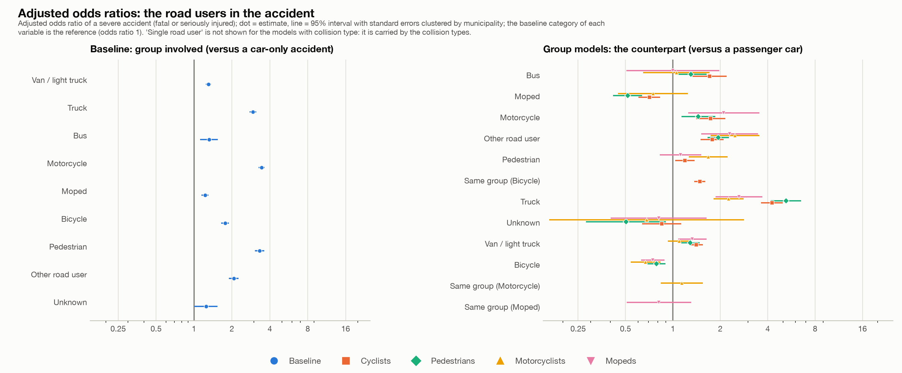
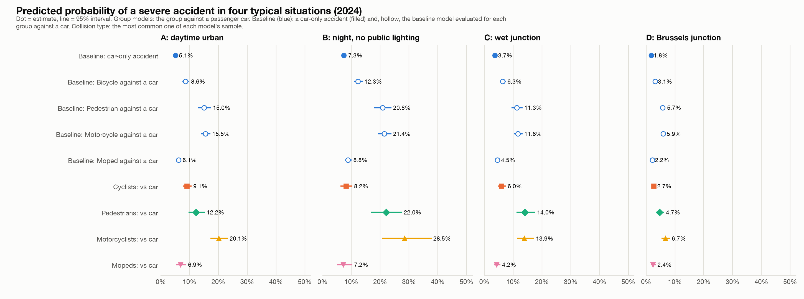

# Road accidents in Belgium 2017-2024: findings of steps 1-5

Report for the course reviewer. Data: Belgian road accident open data 2017-2024, translated to English (289,532 accidents). All numbers come from the scripts in `scripts/` and the tables in `reports/`; `#n` points to an entry in `beslissingslogboek.md`, where each decision and its reason are written down. A longer report with all method details is in `findings_technical_report_steps_1_5.md`.

## Summary on one page

**Question.** Which road user bears the greatest accident burden, who suffers the most severe outcomes, where are vulnerable road users most exposed, and which conditions raise the odds that an accident is severe?

**How the numbers were counted.** One row is one accident. An accident counts once for every road-user group it involves (road user 1 or road user 2), so one accident can count for two groups (#33). The severity class belongs to the whole accident, not to one person. "Severe" means fatal, fatally injured or seriously injured (classes 1-3). These are counts and shares, not rates per amount of traffic: the data has no traffic or population figures.

| Step | Main finding |
|---|---|
| **1. Burden** | Passenger cars (70.2% of accidents) and bicycles (24.8%) are involved most often; pedestrians 10.3%. Almost every group drops in 2020 and rebounds; compared with 2017-2019, accidents with bicycles rose 14.6% in 2022-2024 and mopeds 7.3%, while trucks (-17.2%), motorcycles (-12.9%), cars (-12.2%) and pedestrians (-10.4%) fell. Motorcycle, bicycle and moped accidents peak in summer; pedestrian accidents peak in winter. |
| **2. Severity** | Trucks (5.1% fatal) and motorcycles (2.8%) are the most severe, then pedestrians (2.0%), against 1.4% for all accidents. Fatal plus serious is 17.3% for trucks and 18.9% for motorcycles against 9.9% overall. Mopeds (0.6%), bicycles (0.9%) and cars (1.3%) are the least often fatal. |
| **3. Geography** | Cyclists are in 24.8% of accidents; Antwerpen (7,405), Gent (4,229) and Brussel (2,478) have the most; by share Haacht, Mortsel and Leuven are above 54%. Every municipality where cyclists are more than a third of the accidents is in Flanders. Hotspot squares of pedestrians and motorcyclists are mostly in the Brussels area, of mopeds in Antwerp and Gent. |
| **4. Regions and concentration** | Wallonia has a higher fatal share (2.26%) than Flanders (1.23%) and Brussels (0.42%), while Flanders has more serious injuries. Busy places are less severe: the fatal share falls from 3.00% in squares with one accident to 0.37% in squares with 100+. At the same accident density and road type Wallonia's fatal odds stay 35% higher than Flanders' (odds ratio 1.35). |
| **5. Models** | A logistic model of severe accidents, with standard errors clustered by municipality: against a car-only accident the odds are 3.44 times higher with a motorcycle, 3.32 with a pedestrian, 2.94 with a truck, 1.77 with a bicycle. Night without public lighting raises the odds (1.78). Brussels is much lower than Flanders (0.39). Road users in the same accident do not simply add up. |

**Main caveats.** Associations, not causes. No traffic or population figures, so busy places and common road users appear often for that reason alone. About 10-13% of accidents have no coordinates (more in Wallonia and before 2022), and about 10% have an unknown road user. The pre, during and post "Covid-19" periods are my own definition; the data states no cause.

## Step 1. Which road user bears the greatest accident burden?

**What I did.** I counted the accidents involving each road-user group per year, month and season, and compared three periods I defined myself: pre (2017-2019), during (2020-2021) and post (2022-2024) Covid-19. Seasons are meteorological, in whole months (December to February is winter), because the data has no day of the month (#53). A comparison of urban and rural areas was dropped: the data only has "built-up area" and no official classification (#55).

**Results.**
- Passenger cars are involved in 70.2% of all accidents, bicycles 24.8%, pedestrians 10.3%, vans 8.1%, mopeds 8.0%, motorcycles 6.8%, trucks 4.4% and buses 1.4%. The shares add up to more than 100% because 136,144 accidents involve two different groups. For about one accident in ten (10.7%) the road user is "Unknown".
- Almost every group drops in 2020 (bicycles only -5.5%; buses -37.7% and pedestrians -30.4% most) and rebounds in 2021-2022. By 2024, with 2017 as 100: bicycles 115, mopeds 105, vans and buses 97, pedestrians 86, motorcycles 83, cars 82, trucks 73.
- Average per year 2022-2024 against 2017-2019: bicycles +14.6%, mopeds +7.3%, vans +1.5%, buses -6.4%, pedestrians -10.4%, cars -12.2%, motorcycles -12.9%, trucks -17.2%.
- Motorcycles have 13.0% of their accidents in winter and 32.6% in summer; bicycles and mopeds also peak in the warm months. Pedestrians are the reverse: 28.0% in winter and 21.3% in summer, with a peak in December (index 123). Cars, vans and trucks are fairly even.

**Read with care.** These are counts: a group that is common on the road appears often for that reason alone. "Unknown" more than doubles from 2017 to 2024 (+113%), so part of the decline of the named groups may be recording shifting into "Unknown"; the data cannot show that.

## Step 2. Who experiences the most severe outcomes?

**What I did.** For each group I calculated the share of its accidents that are fatal, seriously injured and slightly injured, with 95% Wilson intervals (#74), and compared them with all accidents.

**Results.**
- Fatal share: trucks 5.1% (3.6 times the 1.4% of all accidents), motorcycles 2.8%, pedestrians 2.0%, buses 1.6%, vans 1.5%, cars 1.3%, bicycles 0.9%, mopeds 0.6%.
- Serious-injury share: motorcycles 16.2%, trucks 12.2%, pedestrians 10.8%, bicycles 10.0% (against 8.4% overall). Bicycle accidents are less often fatal but more often serious.
- Fatal plus serious: trucks 17.3%, motorcycles 18.9%, against 9.9% for all accidents.
- The fatal share of all accidents falls from 1.54% (2017-2019) to 1.47% (2020-2021) and 1.29% (2022-2024).

**Read with care.** These shares describe the accidents a group is part of, not the harm to that group's own members: a truck accident may be fatal mostly for the other party. They are shares given that an accident happened, not the risk of having one.

## Step 3. Where are vulnerable road users most exposed?

**What I did.** I used the accident coordinates (Belgian Lambert 1972) and the Statbel municipality outlines (CC BY 4.0) to map cyclist accidents per municipality (and the same for pedestrians, motorcycles and mopeds, #159), and a 500 m square grid to find hotspots for pedestrians, motorcycles and mopeds (#86). Two impossible coordinates were treated as missing (#90).

**Results.**
- 71,881 accidents involve cyclists, in 577 of the 581 municipalities. By count: Antwerpen 7,405 (37% of its accidents), Gent 4,229 (42%), Brussel 2,478 (25%), Leuven 1,773 (54%), Brugge 1,598 (37%).
- By share (municipalities with 100+ accidents): Haacht 56.2%, Mortsel 54.4%, Leuven 54.3%, Hove 50.4%, Keerbergen 49.0%. Cyclist share by region: Flanders 33.5%, Brussels 21.8%, Wallonia 7.0%.
- By municipality, the same view for the other groups. Pedestrians: Antwerpen 2,687, Brussel 1,637, Gent 1,157 by number; Koekelberg 31.5%, Sint-Jans-Molenbeek 30.8% and Jette 30.1% by share (all Brussels). Motorcycles: Brussel 1,351, Antwerpen 1,029, Gent 427; by share small Walloon municipalities lead (Stoumont 32.7% of 113 accidents). Mopeds: Antwerpen 2,250, Gent 1,215, Brugge 610; the five highest shares (Hemiksem 20.3%) are all in Flanders.
- Pedestrians: 17 of the 20 busiest squares are in the Brussels area, 2 in Antwerp, 1 in Liege; the busiest has 82 accidents. Motorcycles: all 20 are in the Brussels area (busiest 41). Mopeds: 12 in Antwerp, 4 in Gent, 2 in Brussels, 1 in Charleroi, 1 in Knokke-Heist (busiest 45).
- About two thirds of the hotspot squares come back in 2022-2024 (12, 16 and 12 of 20).

**Read with care.** Counts favour big cities and there are no population or cycling figures, so these are not rates. Hotspots are where accidents are counted, which is mostly where many people and vehicles are. 10-13% of accidents have no coordinates (3-5% in 2022-2024), more in Wallonia, so Walloon hotspots may be understated.

## Step 4. Regional severity, and concentration against severity

**What I did.** I compared severity between regions and provinces, between 500 m squares with few and many accidents, and between five equal-sized classes of municipality density. To see whether the Wallonia-Flanders gap remains at the same density, I used direct standardisation and a logistic regression with bootstrap intervals.

**Results.**
- Fatal share: Wallonia 2.26% (1.6 times Belgium), Flanders 1.23%, Brussels 0.42%. The serious-injury share goes the other way: Flanders 9.67%, Wallonia 7.16%, Brussels 4.45%. The order holds for cyclists, pedestrians, motorcycles and mopeds, and on every road type (motorways 4.01% against 2.39%).
- The busier the square, the less severe the accidents: the fatal share falls from 3.00% in squares with one accident to 0.37% in squares with 100 or more; the serious share from 12.5% to 5.1%. By municipality it falls from 3.66% in the least dense fifth to 0.80% in the densest (Spearman rho -0.66).
- At the same density Wallonia's fatal share stays 36-48% higher than Flanders' in every density class. Adjusted odds ratio, Wallonia against Flanders: 1.86 (region only), 1.39 (same density), 1.35 (also same road type; 95% interval 1.25-1.44). Density and road type explain more than half of the excess; roughly 40% remains. The gap remains for mopeds (1.70) and is borderline for pedestrians (1.23) and motorcycles (1.21); not for cyclists (0.69).

**Read with care.** Hotspots are not the deadliest places: an isolated pedestrian accident is fatal in 4.3% of cases, one in a busy square in under 1%. This is an association: dense places differ in speed, road type and the mix of accidents. Flanders has more serious but fewer fatal accidents than Wallonia; that could be real or come from how classes are recorded, and I did not test it. Only density and road type are matched.

## Step 5. Logistic models of accident severity

**What I did.** I estimated a binary logistic model of Severe (fatal, fatally injured or seriously injured; 28,532 of 289,532 accidents) on road-user group, year, month, region, road type, intersection, lighting, weather, road surface and collision type. There is a baseline model and one each for cyclists, pedestrians, motorcyclists and mopeds. Because the rows are accidents and not participants, and accidents in one municipality are correlated, standard errors are clustered by municipality (581 clusters). In the baseline, each road-user group is a yes/no variable ("involved"); in the group models the road-user variable is the counterpart. I tested interactions between the groups in the same accident and compared the models by odds ratios, predicted probabilities, fit and typical situations.

**Results.**
- Baseline, against a car-only accident: motorcycle 3.44, pedestrian 3.32, truck 2.94, bicycle 1.77, moped 1.22 (all clearly above 1).
- Night without public lighting raises the odds (1.78 in the baseline; 2.04 for pedestrians, 2.01 for motorcyclists). Brussels has much lower odds than Flanders in every model (0.29 to 0.41), Wallonia somewhat lower (0.74 to 0.81).
- In the group models a truck as counterpart is the strongest risk factor, against a passenger car: 5.22 for pedestrians, 4.26 for cyclists, 2.63 for mopeds, 2.26 for motorcyclists.
- Clustering matters: the intraclass correlation is 0.016 in the baseline, and the cluster-robust standard errors are on average 11% larger, up to 3.8 times for region terms.
- The road users do not simply add up: 22 pairs tested jointly (p < 10^-180). Bicycle + pedestrian is far less severe than the two effects added (0.33), car + motorcycle more (1.48). The order of road user 1 and 2 also matters (p = 2 x 10^-9), but their meaning is undocumented, so I do not interpret it.
- Predicted probability in a daytime urban situation in 2024: car-only accident 5.1%, bicycle against a car 8.6%, pedestrian 15.0%, motorcycle 15.5%.

| Model | Accidents | Severe | AUC (in-sample) | McFadden R2 |
|---|---|---|---|---|
| Baseline | 289,532 | 28,532 | 0.68 | 0.058 |
| Cyclists | 71,881 | 7,852 | 0.65 | 0.042 |
| Pedestrians | 29,897 | 3,820 | 0.67 | 0.063 |
| Motorcyclists | 19,792 | 3,749 | 0.68 | 0.069 |
| Mopeds | 23,258 | 1,985 | 0.65 | 0.041 |

**Read with care.** Associations, not causes: speed, traffic, vehicle type and helmet use are not in the data. AUC is in-sample. "With a pedestrian" (collision type) is 99% the same as the pedestrian road-user term and is left out of the models; without collision type the pedestrian odds ratio is 2.54 instead of 3.32 (#119). An accident with a cyclist and a pedestrian is in both group models.

## What I could not or did not do

- **No rates.** There are no traffic, population or exposure figures in the data, so nothing here says which road user is riskier per kilometre.
- **Missing information.** About 10-13% of accidents have no coordinates and about 10% have an unknown road user, and both are not random (more in Wallonia and Brussels in some years).
- **Not tested.** Whether the Wallonia-Flanders difference in fatal against serious accidents comes from how the classes are recorded; why empty coordinates jump in Brussels in 2024; the difference between the classes "with fatalities" and "fatally injured".
- **Not done.** Urban against rural (#55), a mixed model with a random municipality effect (#121), and an out-of-sample test of the models.

## Where to find things

- Decisions and reasons: `beslissingslogboek.md` (#1-#161).
- Code: `scripts/` (steps 8-24), the dashboard code in `dashboard_*.py` and the interactive tool in `app.py` with `tool_*.py` and `logit_live.py`.
- Result tables and charts: `reports/`.
- Interactive tools: the Streamlit app (`streamlit run app.py`) lets you filter by year, region, road and light conditions and compare groups, estimate the models on your own selection and export tables, charts and data. A private claude.ai page shows the saved results of steps 1-5, including the municipality top 20 per group with buttons for group, ranking, period and region.
