# Road accidents in Belgium 2017-2024: full technical report of steps 1-5

Data: Belgian road accident open data 2017-2024, translated to English (289,532 accidents, 32 columns in the flagged file). This report is the long version of `findings_summary_steps_1_5.md`: the same findings with the tables of the key numbers, the method in detail and the robustness checks. Every table is read from the saved result files in `reports/` by `scripts/22_build_technical_report.py`. `#n` points to an entry in `beslissingslogboek.md`, where the decision and its reason are written down.

## Contents

0. Data and counting rules
1. Step 1: the burden per road-user group
2. Step 2: severity per road-user group
3. Step 3: geography of vulnerable road users
4. Step 4: regional severity, concentration and density
5. Step 5: logistic models of severity
6. The interactive tools and how they were checked
7. Limits, open questions and what was not done

## 0. Data and counting rules

**Data.** One row is one accident (the data has no identifier to prove it). The Dutch and French source was translated to English with an approved list of 120 translations (#1-#10). Possible duplicates were flagged and not removed, and nothing was filled in or removed for empty cells (#20). 12.39% of accidents have no coordinates (35,881) and 10.37% have no province (all Brussels, where "no province" means "not applicable").

**Counting rule (#33).** An accident counts once for every road-user group it involves: road user 1 OR road user 2. One accident can therefore count for two groups, and shares add up to more than 100%: 136,144 accidents involve two different groups. "Single road user" accidents are not a road user. The meaning of "road user 1" and "road user 2" is not documented, so the order is not interpreted except where tested (step 5).

**Severity (#116).** The accident class belongs to the whole accident. Fatal = classes 1 and 2 (fatalities and fatally injured), serious = class 3, slight = class 4. "Severe" = classes 1-3 (28,532 accidents, 9.85%): 3,077 + 1,064 + 24,391.

**Unknown categories (#18, #22).** Unknown stays a category. In the explanatory variables the share unknown or not specified is: weather 9.6%, road surface 8.4%, collision type 8.9%, lighting 3.4%, road type 0.5%. 47,340 accidents (16.4%) have at least one unknown among weather, road surface, lighting, road type and collision type, and about 10% have an unknown road user.

**Intervals.** Shares carry 95% Wilson intervals (#74). A share is not shown for fewer than 30 accidents and flagged as unstable below 100 (#141, in the interactive tool).

**Coordinates.** Belgian Lambert 1972 (EPSG:31370, metres). Two impossible coordinates are treated as missing (#90). Municipality outlines: Statbel statistical sectors 2023 (CC BY 4.0), joined into 581 municipalities and 11 province areas (Brussels included).

## 1. Step 1: the burden per road-user group

**Method.** Accidents per group in total, per year, per month and per season. Three periods that I defined myself: pre (2017-2019), during (2020-2021) and post (2022-2024) "Covid-19". The data states no cause. Seasons are meteorological, in whole months (winter = December to February), because the data has no day (#53). The seasonal index is the share of a group's accidents in a month (or season) divided by the even share (100 = average); it is not corrected for month length, so I also give accidents per day. An urban against rural comparison was dropped because the data has only "built-up area" (#55).

**Accidents per group, 2017-2024.**

| Road-user group | Accidents | % of all accidents |
|---|---|---|
| Passenger car | 203,159 | 70.2% |
| Bicycle | 71,881 | 24.8% |
| Unknown | 31,086 | 10.7% |
| Pedestrian | 29,897 | 10.3% |
| Van / light truck | 23,557 | 8.1% |
| Moped | 23,258 | 8.0% |
| Motorcycle | 19,792 | 6.8% |
| Truck | 12,595 | 4.4% |
| Other road user | 6,356 | 2.2% |
| Bus | 4,095 | 1.4% |

**Accidents per year, the index for 2024 and the change between the pre and post periods.**

| Group | 2017 | 2018 | 2019 | 2020 | 2021 | 2022 | 2023 | 2024 | Index 2024 (2017 = 100) | Post vs pre (avg/yr) |
|---|---|---|---|---|---|---|---|---|---|---|
| Passenger car | 28,810 | 28,375 | 27,388 | 20,534 | 23,833 | 25,558 | 25,047 | 23,614 | 82 | -12.2% |
| Bicycle | 7,989 | 8,601 | 8,856 | 8,368 | 8,897 | 10,273 | 9,707 | 9,190 | 115 | +14.6% |
| Unknown | 2,612 | 3,239 | 3,195 | 3,208 | 3,879 | 4,663 | 4,724 | 5,566 | 213 | +65.3% |
| Pedestrian | 4,155 | 4,084 | 4,170 | 2,904 | 3,460 | 3,724 | 3,816 | 3,584 | 86 | -10.4% |
| Van / light truck | 2,998 | 2,928 | 3,008 | 2,563 | 2,992 | 3,132 | 3,027 | 2,909 | 97 | +1.5% |
| Moped | 2,858 | 2,924 | 2,907 | 2,299 | 2,943 | 3,178 | 3,149 | 3,000 | 105 | +7.3% |
| Motorcycle | 2,765 | 2,837 | 2,639 | 2,148 | 2,227 | 2,503 | 2,376 | 2,297 | 83 | -12.9% |
| Truck | 1,910 | 1,682 | 1,714 | 1,373 | 1,521 | 1,498 | 1,494 | 1,403 | 73 | -17.2% |
| Other road user | 700 | 705 | 838 | 619 | 783 | 918 | 904 | 889 | 127 | +20.9% |
| Bus | 566 | 544 | 581 | 362 | 459 | 544 | 491 | 548 | 97 | -6.4% |

**Findings.**
- Passenger cars and bicycles are involved most often (70.2% and 24.8%). "Unknown" is 10.7%: for about one accident in ten the road user is not recorded, and its share more than doubles from 2017 to 2024 (+113%), so part of the decline of named groups may be recording moving into "Unknown".
- Almost every group drops in 2020 and rebounds in 2021-2022. Bicycles drop only 5.5% in 2020; buses (-37.7%) and pedestrians (-30.4%) drop most. Bicycles (+14.6%) and mopeds (+7.3%) are above their 2017-2019 level in 2022-2024; trucks (-17.2%), motorcycles (-12.9%), cars (-12.2%) and pedestrians (-10.4%) are below it.
- Motorcycles have 13.0% of their accidents in winter and 32.6% in summer; bicycles and mopeds also peak in warm months. Pedestrians are the reverse (28.0% winter, 21.3% summer; December index 123). Per day, January is the quietest month for all accidents (84.8 a day), not February (91.2): February's low index is partly its length. In 2020-2021 the spring share is lower for every group (20.6% against 25.1% before); from 2022 the pattern looks like before.

**Limits.** Counts, not rates: a common road user appears often for that reason alone. The seasonal explanations (riding in good weather, darker months for pedestrians) were not tested.

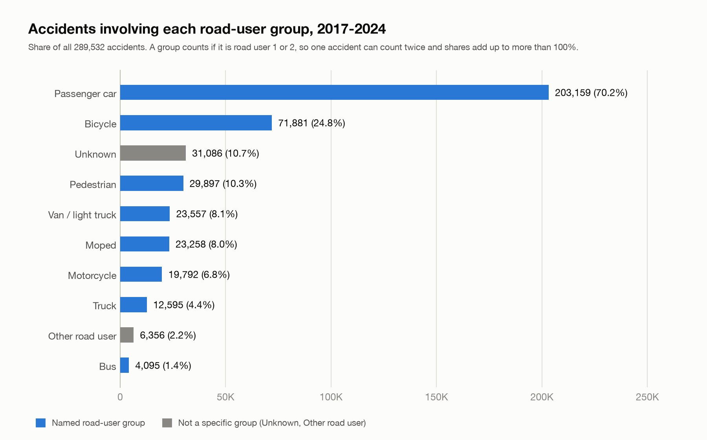

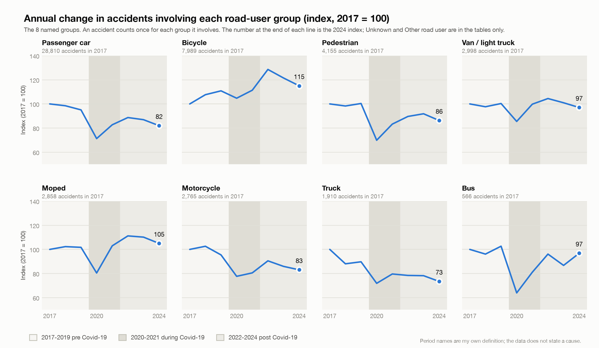

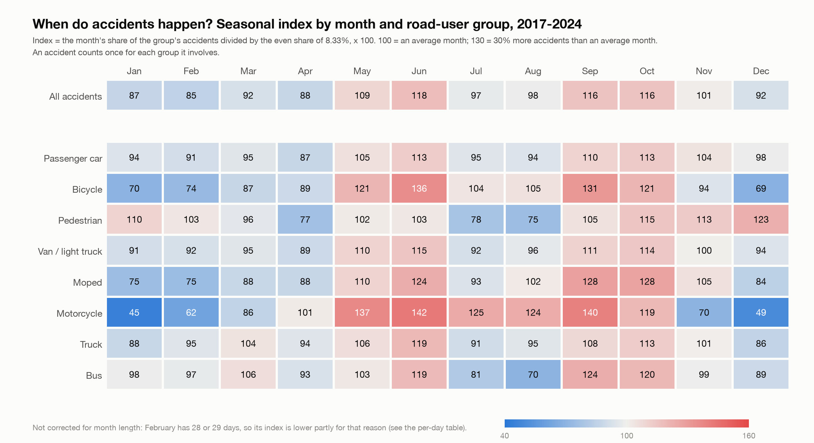

## 2. Step 2: severity per road-user group

**Method.** For every group: the shares of its accidents that are fatal, seriously injured and slightly injured, with 95% Wilson intervals, the ratio and the gap in points against all accidents, for all years together and for the three periods. The stacked distribution splits the fatal class into classes 1 and 2.

| Group | Accidents | Fatal (class 1+2) | fatal 95% interval | Seriously injured (class 3) | Slightly injured (class 4) | Fatal + serious |
|---|---|---|---|---|---|---|
| All accidents | 289,532 | 1.43% | 1.39-1.47% | 8.42% | 90.14% | 9.9% |
| Passenger car | 203,159 | 1.31% | 1.26-1.36% | 7.33% | 91.37% | 8.6% |
| Bicycle | 71,881 | 0.90% | 0.84-0.98% | 10.02% | 89.08% | 10.9% |
| Unknown | 31,086 | 0.69% | 0.61-0.79% | 6.17% | 93.14% | 6.9% |
| Pedestrian | 29,897 | 1.96% | 1.81-2.12% | 10.82% | 87.22% | 12.8% |
| Van / light truck | 23,557 | 1.51% | 1.36-1.68% | 8.47% | 90.02% | 10.0% |
| Moped | 23,258 | 0.57% | 0.48-0.68% | 7.96% | 91.47% | 8.5% |
| Motorcycle | 19,792 | 2.76% | 2.54-3.00% | 16.18% | 81.06% | 18.9% |
| Truck | 12,595 | 5.14% | 4.76-5.54% | 12.16% | 82.71% | 17.3% |
| Other road user | 6,356 | 2.94% | 2.55-3.39% | 10.76% | 86.30% | 13.7% |
| Bus | 4,095 | 1.64% | 1.29-2.07% | 7.33% | 91.04% | 9.0% |

**Findings.**
- The fatal share is highest for trucks (5.1%, 3.6 times the 1.4% of all accidents), motorcycles (2.8%) and pedestrians (2.0%) and lowest for mopeds (0.6%), bicycles (0.9%) and passenger cars (1.3%). The intervals of trucks and motorcycles do not overlap that of all accidents.
- Bicycle accidents are less often fatal but more often seriously injured (10.0% against 8.4% overall); motorcycles have the highest serious share (16.2%).
- The fatal share of all accidents falls from 1.54% (2017-2019) to 1.47% (2020-2021) and 1.29% (2022-2024).

**Limits.** These are the severities of the accidents a group is part of, not the harm to that group's own members, and shares given that an accident happened, not risks. Intervals assume independent accidents, which is slightly optimistic because one accident can count for two groups.

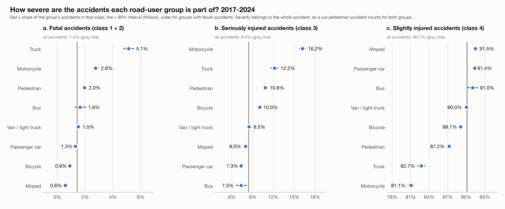

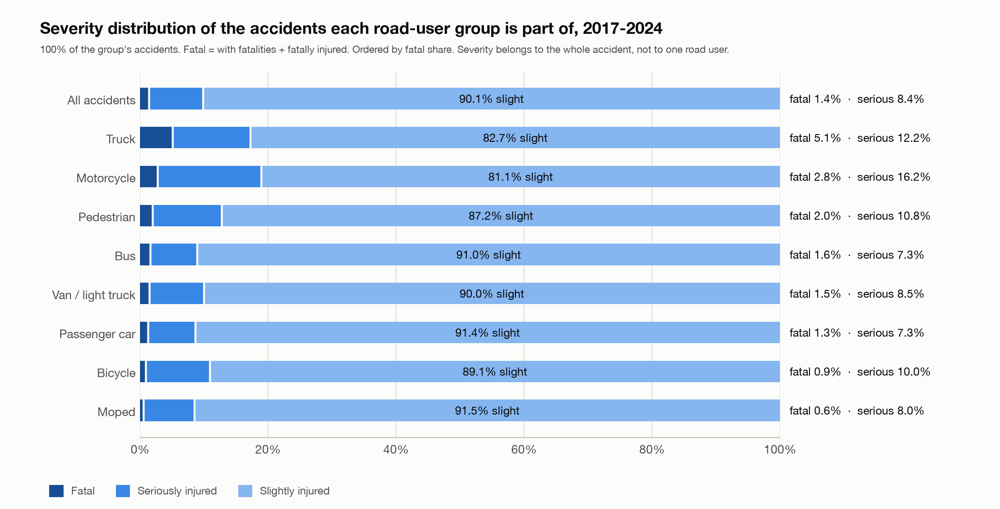

## 3. Step 3: geography of vulnerable road users

**Method.** (a) Cyclists by municipality: the number of accidents involving cyclists and their share of all the municipality's accidents (shares for municipalities with 100+ accidents), mapped as a bubble map and a choropleth with five quantile classes. (b, c) Hotspots for pedestrians, motorcycles and mopeds in 500 m squares of the Lambert grid (#86), for all years and for 2022-2024 (when coordinates are most complete); the 20 busiest squares are ranked and named after the municipality where most of their accidents are. Accidents without usable coordinates are left out of the maps and counted separately. (b, c, municipalities) The municipality view of (a) is repeated for pedestrians, motorcycles and mopeds with the same rules (#159): the top 20 by number and by share, a bubble map and a choropleth; a share needs 100+ accidents in the municipality (#161). The interactive tools take this further: the ranking, the maps and the table can be filtered by group, period, region and, in the Streamlit tool, by every sidebar filter (#160).

**The ten municipalities with the most accidents involving cyclists** (71,881 accidents in 577 of the 581 municipalities).

| Municipality | Region | All accidents | Involving cyclists | Cyclist share |
|---|---|---|---|---|
| Antwerpen | Flemish Region | 19,867 | 7,405 | 37.3% |
| Gent | Flemish Region | 10,183 | 4,229 | 41.5% |
| Brussel | Brussels-Capital Region | 9,949 | 2,478 | 24.9% |
| Leuven | Flemish Region | 3,267 | 1,773 | 54.3% |
| Brugge | Flemish Region | 4,318 | 1,598 | 37.0% |
| Sint-Niklaas | Flemish Region | 3,025 | 1,341 | 44.3% |
| Kortrijk | Flemish Region | 2,675 | 977 | 36.5% |
| Mechelen | Flemish Region | 2,099 | 948 | 45.2% |
| Elsene | Brussels-Capital Region | 2,755 | 893 | 32.4% |
| Aalst | Flemish Region | 2,332 | 781 | 33.5% |

**The five highest cyclist shares (municipalities with 100+ accidents).**

| Municipality | Region | All accidents | Cyclist share |
|---|---|---|---|
| Haacht | Flemish Region | 256 | 56.2% |
| Mortsel | Flemish Region | 734 | 54.4% |
| Leuven | Flemish Region | 3,267 | 54.3% |
| Hove | Flemish Region | 133 | 50.4% |
| Keerbergen | Flemish Region | 196 | 49.0% |

**Findings.**
- Cyclists are in 24.8% of all accidents; by region 33.5% in Flanders, 21.8% in Brussels and 7.0% in Wallonia. Wherever cyclists are more than a third of the accidents, the municipality is in Flanders.
- Pedestrians: 17 of the 20 busiest squares are in the Brussels area, 2 in Antwerp and 1 in Liege; the busiest (Antwerp) has 82 accidents, only 0.31% of all located pedestrian accidents. Motorcycles: all 20 are in the Brussels area (busiest 41). Mopeds: 12 in Antwerp, 4 in Gent, 2 in Brussels, 1 in Charleroi, 1 in Knokke-Heist (busiest 45).
- About two thirds of the hotspot squares come back in 2022-2024 (12, 16 and 12 of 20 for pedestrians, motorcycles and mopeds).
- Municipalities, pedestrians, motorcycles and mopeds (all years, Belgium): the biggest cities lead by number, small municipalities lead by share. The top by share is dominated by the Brussels municipalities for pedestrians (Koekelberg 31.5%) and by small Walloon municipalities for motorcycles (Stoumont 32.7%, with 37 of 113 accidents); all five highest moped shares are in Flanders (Hemiksem 20.3%).

**Limits.** Counts favour big cities; there are no population or traffic figures. Hotspots are where accidents are counted, which is mostly where many people and vehicles are. 10-13% of accidents have no coordinates (3-5% in 2022-2024), more in Wallonia, so Walloon hotspots may be understated. A different square size would give different ranks.

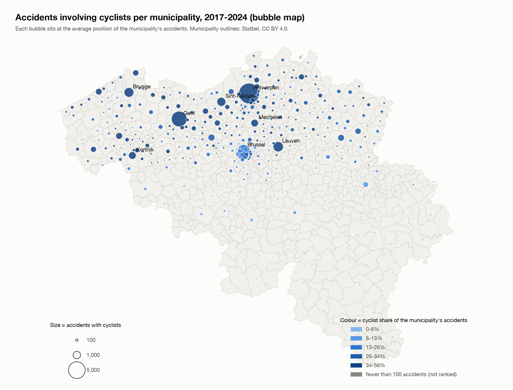

**Pedestrians, motorcycles and mopeds by municipality (script 24).** Top 5 by number and by share; the full top 20, the maps and the table of all 581 municipalities per group are in `reports/geo_a_*_by_municipality.csv` and the charts `geo_a_*_ranked.png`.

| Group | Accidents (municipalities with at least one) | Top 5 by number | Top 5 by share (100+ accidents) | Share by region |
|---|---|---|---|---|
| Pedestrians | 29,897 (572) | Antwerpen 2,687, Brussel 1,637, Gent 1,157, Luik 1,109, Charleroi 809 | Koekelberg 31.5%, Sint-Jans-Molenbeek 30.8%, Jette 30.1%, Sint-Agatha-Berchem 29.9%, Sint-Gillis 29.6% | Brussels 21.9%, Wallonia 10.8%, Flanders 8.2% |
| Motorcycles | 19,792 (578) | Brussel 1,351, Antwerpen 1,029, Gent 427, Luik 416, Anderlecht 352 | Stoumont 32.7%, Froidchapelle 32.6%, Cerfontaine 29.4%, La Roche-en-Ardenne 28.0%, Bouillon 24.1% | Brussels 11.2%, Wallonia 8.3%, Flanders 5.4% |
| Mopeds | 23,258 (568) | Antwerpen 2,250, Gent 1,215, Brugge 610, Brussel 588, Charleroi 444 | Hemiksem 20.3%, Lanaken 18.9%, Schilde 18.2%, Schelle 16.9%, Niel 16.6% | Flanders 9.5%, Wallonia 5.9%, Brussels 5.3% |

Counts and shares are not rates: there are no population or traffic figures, and a share in a small municipality moves with a few accidents (the five highest motorcycle shares come from 113 to 203 accidents each).

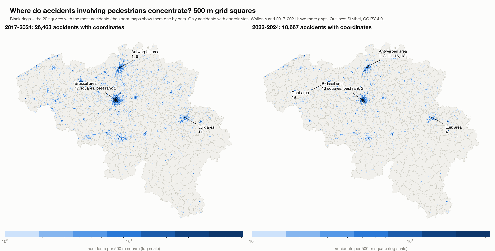

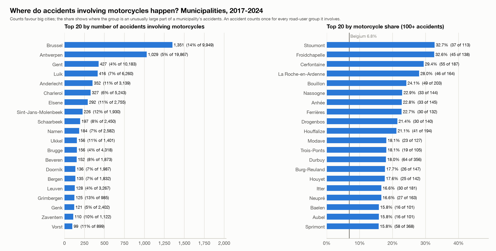

## 4. Step 4: regional severity, concentration and density

### 4a. Regional severity

**Method.** Fatal and serious shares per region and province, for all accidents and for cyclists, pedestrians, motorcycles and mopeds, and per road type (motorway, regional road, municipal road).

| Level | Area | Accidents | Fatal share | Serious share |
|---|---|---|---|---|
| Belgium | Belgium | 289,532 | 1.43% | 8.42% |
| Region | Brussels-Capital Region | 30,022 | 0.42% | 4.45% |
| Region | Flemish Region | 178,348 | 1.23% | 9.67% |
| Region | Walloon Region | 81,162 | 2.26% | 7.16% |
| Province | Antwerp | 53,106 | 1.04% | 9.04% |
| Province | Brussels (no province) | 30,022 | 0.42% | 4.45% |
| Province | East Flanders | 46,193 | 1.07% | 10.47% |
| Province | Flemish Brabant | 23,990 | 1.23% | 8.08% |
| Province | Hainaut | 28,397 | 2.17% | 8.03% |
| Province | Limburg | 21,766 | 1.67% | 8.44% |
| Province | Liège | 25,907 | 1.93% | 6.05% |
| Province | Luxembourg | 7,027 | 3.37% | 10.70% |
| Province | Namur | 11,642 | 2.95% | 6.80% |
| Province | Walloon Brabant | 8,189 | 1.64% | 5.13% |
| Province | West Flanders | 33,293 | 1.44% | 11.50% |

**Findings.** Wallonia has a fatal share 1.6 times that of Belgium, and Brussels 0.29 times; the serious-injury share goes the other way. The province with the highest fatal share is Luxembourg (3.37%), then Namur (2.95%) and Hainaut (2.17%); the lowest are Antwerp (1.04%) and Brussels (0.42%). The serious share is highest in West Flanders (11.5%). The order Brussels, Flanders, Wallonia in the fatal share holds for all four groups and on every road type: motorways 4.01% in Wallonia against 2.39% in Flanders, regional roads 2.54% against 1.22%, municipal roads 1.52% against 1.02%.

### 4b. Concentration against severity

**Method.** Each accident gets the number of accidents in its 500 m square (accidents with coordinates, two periods; classes 1, 2-4, 5-9, 10-19, 20-49, 50-99, 100+ (#100)); separately, municipalities are put in five equal-sized classes of accidents per km2 per year of the group, using the municipality areas from the Statbel outlines. Spearman's rank correlation links municipality density to severity (municipalities with 100+ accidents; for a group, 30+ of its accidents).

| Accidents in the 500 m square | Accidents | Fatal share | Serious share |
|---|---|---|---|
| 1 | 14,916 | 3.00% | 12.50% |
| 2-4 | 40,437 | 2.45% | 11.44% |
| 5-9 | 43,875 | 2.06% | 9.81% |
| 10-19 | 46,821 | 1.38% | 8.50% |
| 20-49 | 54,031 | 0.80% | 7.07% |
| 50-99 | 31,398 | 0.46% | 6.00% |
| 100+ | 22,171 | 0.37% | 5.10% |

| Density class (1 = least dense) | Municipalities | Accidents | Fatal share | Serious share |
|---|---|---|---|---|
| 1 | 117 | 15,111 | 3.66% | 11.03% |
| 2 | 116 | 24,317 | 2.52% | 10.11% |
| 3 | 116 | 36,976 | 2.02% | 10.63% |
| 4 | 116 | 60,167 | 1.67% | 9.44% |
| 5 | 116 | 152,961 | 0.80% | 6.97% |

| Group | Municipalities (100+ accidents) | Spearman rho (density vs fatal share) |
|---|---|---|
| All accidents | 504 | -0.66 |
| Bicycle | 327 | -0.22 |
| Pedestrian | 189 | -0.36 |
| Motorcycle | 180 | -0.52 |
| Moped | 178 | -0.15 |

**Findings.** The busier the place, the less severe the accidents. For all accidents the fatal share falls from 3.00% in squares with one accident to 0.37% in squares with 100 or more (the serious share from 12.5% to 5.1%), and from 3.66% in the least dense fifth of municipalities to 0.80% in the densest. The same direction holds for cyclists (fatal 1.93% to 0.17%) and pedestrians (4.29% to 0.70%), motorcycles and mopeds, and in 2022-2024. Hotspots are therefore not the deadliest places: an isolated pedestrian accident is fatal in 4.3% of cases, one in a busy square in under 1%. This is an association: dense places differ in speed, road types and the mix of accidents, and density is accidents per km2, not per vehicle.

### 4c. Regions within the same density

**Method.** Is the Wallonia-Flanders gap still there when municipalities of the same accident density (and road type) are compared? Two ways. (1) Direct standardisation: Wallonia's share if it had Flanders' mix of strata (5 density classes, or 15 strata of density class and road type), with the ratio against the crude Wallonia share. (2) A logistic regression of the outcome on region, then adding density class, then adding road type, estimated on aggregated cells (33 cells) with 1,000 multinomial bootstrap repetitions for the intervals; I checked the coefficients against a hand-written iteratively reweighted least squares fit. Brussels is only in the densest class, so the comparison is mostly Wallonia against Flanders.

**Odds ratio Wallonia against Flanders, all accidents.**

| Outcome | Model | Odds ratio | 95% low | 95% high |
|---|---|---|---|---|
| fatal | region only | 1.86 | 1.74 | 1.99 |
| fatal | + density class | 1.39 | 1.30 | 1.50 |
| fatal | + density class + road type | 1.35 | 1.25 | 1.44 |
| serious | region only | 0.72 | 0.70 | 0.74 |
| serious | + density class | 0.60 | 0.58 | 0.62 |
| serious | + density class + road type | 0.60 | 0.58 | 0.63 |

**Findings.** At the same accident density Wallonia's fatal share stays 36-48% higher than Flanders' in every density class (ratios 1.48, 1.36, 1.36, 1.37 and 1.44; overall 1.84). The adjusted fatal odds ratio falls from 1.86 to 1.39 (same density class) and 1.35 (also same road type; 95% interval 1.25-1.44): density and road type explain more than half of the excess and roughly 40% of it remains. The serious-injury gap goes the other way and widens when matched (0.72 crude, 0.60 at the same density and road type). By group (fatal, density plus road type): mopeds 1.70 (the gap remains), pedestrians 1.23 and motorcycles 1.21 (borderline), cyclists 0.69 (no clear gap: the interval of the standardised ratio includes 1).

**Limits.** Only density and road type are matched; speed limits, vehicle mix, enforcement, emergency response and how classes are recorded are not. That Flanders has more serious but fewer fatal accidents than Wallonia could be real or a recording difference; I did not test it.

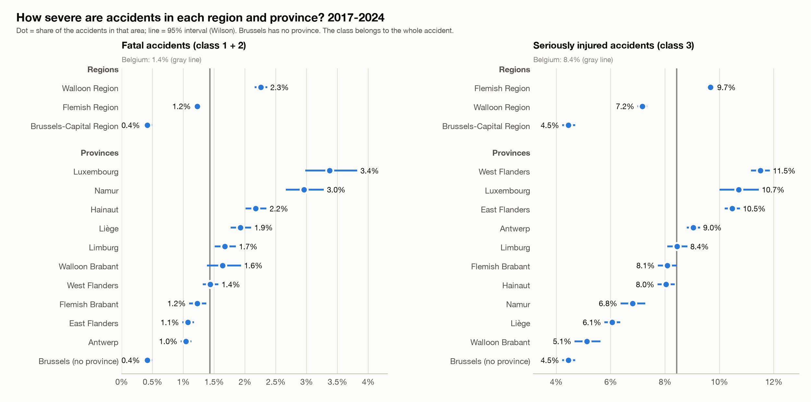

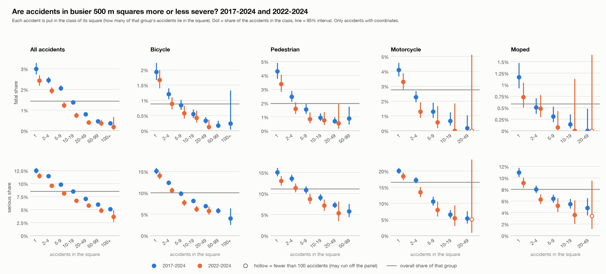

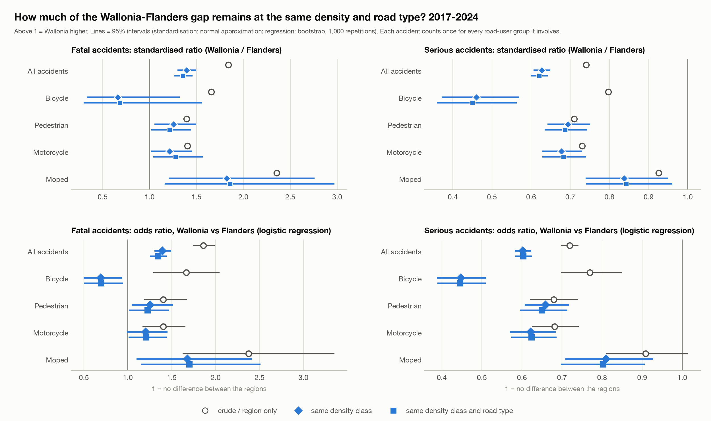

## 5. Step 5: logistic models of severity

### 5a. Specification

**Outcome and variables.** Severe = 1 for classes 1-3 and 0 for class 4 (#116). Explanatory variables: road-user group, year (categories, reference 2017), month (categories, reference January) (#124), region, road type, intersection, lighting, weather, road surface and collision type. Reference categories (#128): Flanders, municipal road, not at an intersection, daylight, normal weather, dry road, rear-end collision between two drivers; baseline road-user group: passenger car only.

**Road-user group (#117, #120).** Because every accident has two road-user roles and their meaning is undocumented, the baseline uses one yes/no variable per group involved (road user 1 OR 2); passenger car is the omitted group, so every odds ratio compares with a car-only accident. "Single road user" is its own yes/no variable in the models without collision type; with collision type it is perfectly collinear with the single-user collision types and carried by them. In the four group models (cyclists, pedestrians, motorcyclists, mopeds) the variable is the counterpart in the accident (car, van, truck, bus, motorcycle, moped, bicycle, pedestrian, other, unknown, or the same group on both sides).

**Categories (#118, #125, #129).** Unknown stays a category. In weather, road surface and lighting, categories with fewer than 100 accidents on all accidents are merged into "Other / combined" (for example the combinations "Rain + Hail" and "Ice, snow + Clean"), so every model uses the same categories. Within a model, a category with fewer than 30 accidents or with no severe or no non-severe accident is merged into "Other / combined" or into the reference; all merges are saved in `severity_logit_category_merges.csv`.

**Accidents, not participants; clustering (#121).** A row is an accident and carries two roles, and accidents in the same municipality are correlated: across the 504 municipalities with 100+ accidents the severe share runs from 2.5% to 24.8% (standard deviation 4.2 points, against 1.8 expected by chance). The coefficients are the ordinary logistic ones; the standard errors are cluster-robust by municipality (581 clusters, 568-578 in the group models), with the small-sample factor G/(G-1) x (N-1)/(N-k).

**Estimator (#122).** Newton-Raphson (iteratively reweighted least squares) with step-halving and the cluster-robust sandwich, written in the script. Checks: the fast sandwich equals a slow loop version on a test example; the coefficients equal scikit-learn's for the baseline and the moped model; the mean predicted probability equals the observed rate in every model. Nothing was installed in the course environment.

**Collision type (#119).** Collision type is almost determined by the road users. In every model the term "with a pedestrian" is 99.3-99.8% identical to the pedestrian road-user term and the model cannot separate them (coefficients ran off to plus and minus 30 in the first attempt), so the collision-type term is left out and the road-user term stays. Each model was also estimated without collision type.

### 5b. Fit and clustering

| Model | Accidents | Severe | Severe % | Parameters | McFadden R2 | AIC | AUC | ICC outcome | ICC residual | Median SE ratio | Max SE ratio |
|---|---|---|---|---|---|---|---|---|---|---|---|
| Baseline | 289,532 | 28,532 | 9.9 | 68 | 0.058 | 175,769 | 0.680 | 0.016 | 0.009 | 1.11 | 3.80 |
| Cyclists | 71,881 | 7,852 | 10.9 | 62 | 0.042 | 47,608 | 0.647 | 0.025 | 0.016 | 1.02 | 1.78 |
| Pedestrians | 29,897 | 3,820 | 12.8 | 53 | 0.063 | 21,517 | 0.672 | 0.032 | 0.019 | 1.01 | 2.40 |
| Motorcyclists | 19,792 | 3,749 | 18.9 | 61 | 0.069 | 18,012 | 0.683 | 0.044 | 0.018 | 1.02 | 1.76 |
| Mopeds | 23,258 | 1,985 | 8.5 | 61 | 0.041 | 13,138 | 0.649 | 0.019 | 0.014 | 1.02 | 1.21 |

AUC is in-sample (the models were fitted on the same accidents), so it is somewhat optimistic; low McFadden R2 values are normal for accident data. "ICC outcome" is the share of the variation in severe that lies between municipalities; "ICC residual" is what remains after the covariates. The SE ratio is the cluster-robust standard error divided by the ordinary one: on average 1.11 in the baseline, but up to 3.8 for region-level terms, so ignoring the clustering would overstate certainty most for place effects. The highest variance inflation factor is 5.6 (baseline), so no strong overlap remains between the variables.

### 5c. Adjusted odds ratios

Adjusted odds ratios of a severe accident with cluster-robust 95% intervals; * = significant at 5%; models as specified (with collision type).

| Term | Baseline | Cyclists | Pedestrians | Motorcyclists | Mopeds |
|---|---|---|---|---|---|
| Region: Brussels-Capital Region | 0.39* (0.34-0.44) | 0.29* (0.24-0.35) | 0.41* (0.31-0.54) | 0.30* (0.26-0.35) | 0.34* (0.26-0.44) |
| Region: Walloon Region | 0.81* (0.71-0.93) | 0.76* (0.63-0.92) | 0.74* (0.59-0.92) | 0.74* (0.62-0.88) | 0.81* (0.69-0.96) |
| Road type: Motorway | 1.10 (0.98-1.24) | 1.45* (1.03-2.03) | 6.32* (4.43-9.01) | 1.08 (0.91-1.29) | 1.76 (0.81-3.86) |
| Road type: Regional road | 1.11* (1.08-1.15) | 0.99 (0.94-1.04) | 1.39* (1.28-1.51) | 1.12* (1.02-1.23) | 0.95 (0.86-1.05) |
| Intersection: At intersection | 0.88* (0.85-0.91) | 0.95 (0.89-1.02) | 0.86* (0.79-0.93) | 0.94 (0.87-1.02) | 0.98 (0.88-1.10) |
| Lighting: Night, no public lighting | 1.78* (1.64-1.92) | 1.28* (1.04-1.56) | 2.04* (1.59-2.61) | 2.01* (1.51-2.68) | 1.66* (1.21-2.26) |
| Lighting: Night, public lighting present and lit | 1.30* (1.26-1.35) | 1.11* (1.03-1.20) | 1.58* (1.43-1.74) | 1.31* (1.16-1.48) | 1.55* (1.37-1.76) |
| Weather: Rain | 0.90* (0.85-0.95) | 0.79* (0.70-0.91) | 0.85* (0.74-0.98) | 0.86 (0.69-1.07) | 1.03 (0.80-1.32) |
| Road surface: Wet, puddles | 0.92* (0.88-0.97) | 0.98 (0.89-1.08) | 1.14 (0.99-1.30) | 0.82* (0.70-0.97) | 0.76* (0.61-0.94) |
| Year: 2020 | 1.02 (0.96-1.07) | 1.10 (0.98-1.24) | 0.89 (0.78-1.02) | 1.08 (0.92-1.25) | 0.83* (0.70-0.98) |
| Year: 2024 | 0.85* (0.78-0.91) | 0.89 (0.78-1.01) | 0.81* (0.68-0.96) | 0.89 (0.75-1.06) | 0.69* (0.56-0.86) |
| Month: Jun | 1.11* (1.04-1.19) | 1.07 (0.94-1.23) | 1.03 (0.85-1.23) | 1.25 (0.99-1.57) | 1.33* (1.01-1.76) |
| Month: Dec | 1.01 (0.95-1.08) | 0.95 (0.84-1.08) | 1.05 (0.91-1.21) | 0.99 (0.72-1.37) | 1.09 (0.80-1.49) |

**Road users in the baseline** (odds ratio against a car-only accident):

| Group involved | Odds ratio (vs car-only) | 95% interval |
|---|---|---|
| Van / light truck | 1.30 | 1.24-1.37 |
| Truck | 2.94 | 2.76-3.13 |
| Bus | 1.32 | 1.12-1.55 |
| Motorcycle | 3.44 | 3.27-3.63 |
| Moped | 1.22 | 1.15-1.30 |
| Bicycle | 1.77 | 1.65-1.89 |
| Pedestrian | 3.32 | 3.05-3.62 |
| Other road user | 2.07 | 1.89-2.26 |
| Unknown | 1.25 | 1.01-1.54 |

**Counterpart in the group models** (odds ratio against a passenger car; * = significant at 5%):

| Counterpart | Cyclists | Pedestrians | Motorcyclists | Mopeds |
|---|---|---|---|---|
| Bicycle | - | 0.79* | 0.67* | 0.75* |
| Bus | 1.71* | 1.30* | 1.05 | 1.00 |
| Moped | 0.71* | 0.52* | 0.75 | - |
| Motorcycle | 1.74* | 1.45* | - | 2.10* |
| Other road user | 1.77* | 1.94* | 2.48* | 2.29* |
| Pedestrian | 1.19* | - | 1.68* | 1.12 |
| Same group (Bicycle) | 1.48* | - | - | - |
| Same group (Moped) | - | - | - | 0.81 |
| Same group (Motorcycle) | - | - | 1.14 | - |
| Truck | 4.26* | 5.22* | 2.26* | 2.63* |
| Unknown | 0.85 | 0.50* | 0.68 | 0.81 |
| Van / light truck | 1.41* | 1.29* | 1.10 | 1.33* |

**Findings.**
- Against a car-only accident the odds of a severe accident are 3.44 times higher with a motorcycle and 3.32 times with a pedestrian, 2.94 with a truck, 1.77 with a bicycle and 1.22 with a moped.
- A truck as counterpart is the strongest risk factor in every group model (5.22 for pedestrians, 4.26 for cyclists, 2.63 for mopeds, 2.26 for motorcyclists).
- Night without public lighting raises the odds (1.78 in the baseline, 2.04 for pedestrians, 2.01 for motorcyclists). Brussels has much lower odds than Flanders in every model (0.29 to 0.41), Wallonia somewhat lower (0.74 to 0.81). This differs from the raw fatal shares of step 4 because "severe" is dominated by serious injuries, and Flanders has the higher serious share.
- A motorway raises the odds for pedestrians a lot (6.32) and for cyclists (1.45), but not significantly for motorcyclists and mopeds. 2024 is below 2017 in the baseline (0.85) and for pedestrians and mopeds; the 2020 coefficient is not different from 2017 except for mopeds (0.83).

**Collision type changes the road-user terms** (baseline, odds ratio with and without collision type):

| Term | With collision type | Without | Change |
|---|---|---|---|
| Group involved: Bicycle | 1.77 | 1.74 | +1% |
| Group involved: Bus | 1.32 | 1.27 | +4% |
| Group involved: Moped | 1.22 | 1.20 | +2% |
| Group involved: Motorcycle | 3.44 | 3.27 | +5% |
| Group involved: Other road user | 2.07 | 2.05 | +1% |
| Group involved: Pedestrian | 3.32 | 2.54 | +31% |
| Group involved: Truck | 2.94 | 2.72 | +8% |
| Group involved: Unknown | 1.25 | 1.66 | -25% |
| Group involved: Van / light truck | 1.30 | 1.26 | +3% |

### 5d. Interactions between road users in the same accident (#123)

**Method.** The baseline plus interaction terms for the 22 pairs of groups that occur together in at least 500 accidents (Unknown excluded), tested jointly with a Wald test using the cluster-robust covariance. A second test checks whether the order (road user 1 or 2) matters for the 10 main pairs (at least 2,000 accidents). For each pair the table gives what the baseline predicts by adding the two group effects ("additive"), the odds ratio with the pair's own effect, and the pair term (a ratio of odds ratios).

| Specification | Test | Terms | Wald chi-square | p-value |
|---|---|---|---|---|
| full | pair interactions (joint) | 22 | 931.7 | 6.7e-183 |
| full | order of road user 1 / 2 (joint) | 10 | 61.4 | 1.9e-09 |
| no_collision | pair interactions (joint) | 22 | 806.9 | 1.9e-156 |
| no_collision | order of road user 1 / 2 (joint) | 10 | 71.4 | 2.4e-11 |

| Pair | Accidents | Severe % | Additive (baseline) | With pair effect | Pair term |
|---|---|---|---|---|---|
| Passenger car + Bicycle | 40,467 | 8.3 | 1.77 | 1.93 | 0.78 |
| Passenger car + Pedestrian | 20,530 | 12.1 | 3.32 | 4.18 | 1.07 |
| Passenger car + Moped | 13,433 | 7.5 | 1.22 | 1.66 | 1.18 |
| Passenger car + Motorcycle | 11,248 | 17.0 | 3.44 | 4.61 | 1.48 |
| Passenger car + Van / light truck | 10,297 | 5.8 | 1.30 | 1.23 | 1.02 |
| Passenger car + Truck | 6,825 | 12.0 | 2.94 | 2.66 | 0.90 |
| Van / light truck + Bicycle | 4,226 | 11.6 | 2.30 | 2.81 | 0.94 |
| Bicycle + Pedestrian | 3,617 | 10.6 | 5.87 | 3.19 | 0.33 |
| Passenger car + Other road user | 2,528 | 8.8 | 2.07 | 2.13 | 0.81 |
| Moped + Bicycle | 2,423 | 6.7 | 2.16 | 1.18 | 0.34 |

**Findings.** The road users in one accident do not simply add up (p < 10^-180, and AIC drops from 175,769 to 174,990). Bicycle + pedestrian is far less severe than the two effects added (pair term 0.33), as are moped + bicycle (0.34) and car + bicycle (0.78); car + motorcycle (1.48) and truck + bicycle (1.19) are worse than additive, and truck + bicycle has the highest severe share of any pair (28.3%). The order of road user 1 and 2 also matters jointly (p = 2 x 10^-9): with a car as road user 1 and a pedestrian as road user 2 the odds are 1.51 times those of the reverse order, and for car + bicycle 1.17. Because the meaning of the two roles is undocumented I report this and do not interpret it.

### 5e. Predicted probabilities and typical situations (#126, #130, #131)

**Method.** Average adjusted predicted probability: for each category of a variable everyone in the model's sample is set to that category, all other variables stay as observed, and the predicted probabilities are averaged (average adjusted prediction). Intervals come from 1,000 draws of the coefficients from their cluster-robust sampling distribution. The four situations (all in 2024) are A: daytime urban (municipal road, daylight, normal weather, dry, not at an intersection, June, Flanders); B: night without public lighting (regional road, October, Wallonia); C: wet junction (regional road, daylight, rain, wet road, at an intersection, November, Flanders); D: Brussels junction (municipal road, daylight, normal, dry, at an intersection, June, Brussels). Collision type: the most common one in each model's sample.

| Model - evaluated as | A: daytime urban | B: night, no public lighting | C: wet junction | D: Brussels junction |
|---|---|---|---|---|
| Baseline - car-only accident | 5.1% (4.5-5.7) | 7.3% (6.5-8.3) | 3.7% (3.2-4.2) | 1.8% (1.6-2.0) |
| Baseline - Bicycle against a car | 8.6% (7.5-9.9) | 12.3% (10.8-13.9) | 6.3% (5.4-7.4) | 3.1% (2.7-3.5) |
| Baseline - Pedestrian against a car | 15.0% (12.9-17.5) | 20.8% (18.0-23.9) | 11.3% (9.4-13.3) | 5.7% (4.8-6.7) |
| Baseline - Motorcycle against a car | 15.5% (13.9-17.3) | 21.4% (19.2-23.9) | 11.6% (10.3-13.3) | 5.9% (5.2-6.6) |
| Baseline - Moped against a car | 6.1% (5.3-7.0) | 8.8% (7.8-10.1) | 4.5% (3.8-5.2) | 2.2% (1.9-2.5) |
| Cyclists - (counterpart: passenger car) | 9.1% (7.6-10.7) | 8.2% (6.2-10.3) | 6.0% (4.7-7.5) | 2.7% (2.2-3.3) |
| Pedestrians - (counterpart: passenger car) | 12.2% (9.6-15.3) | 22.0% (16.7-27.6) | 14.0% (11.1-17.7) | 4.7% (3.5-6.3) |
| Motorcyclists - (counterpart: passenger car) | 20.1% (17.2-23.3) | 28.5% (20.7-37.9) | 13.9% (11.2-17.3) | 6.7% (5.4-8.3) |
| Mopeds - (counterpart: passenger car) | 6.9% (5.3-8.9) | 7.2% (5.0-10.4) | 4.2% (3.2-5.6) | 2.4% (1.7-3.3) |

**Findings.** In a daytime urban situation the predicted probability is 5.1% for a car-only accident, 8.6% for a bicycle against a car, 15.0% for a pedestrian and 15.5% for a motorcycle; at night without public lighting on a regional road in Wallonia the pedestrian model gives 22.0% and the motorcyclist model 28.5%. The models cover different accidents, so the levels of the five models differ by design.

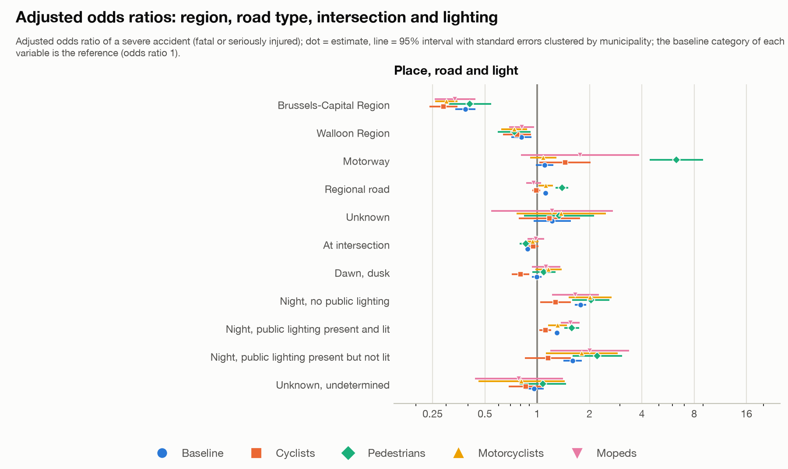

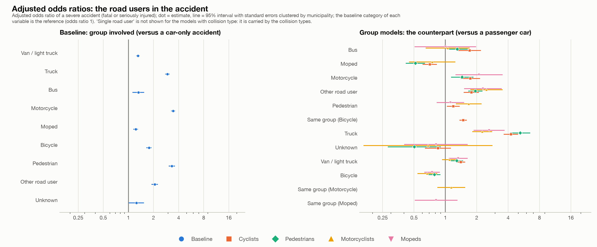

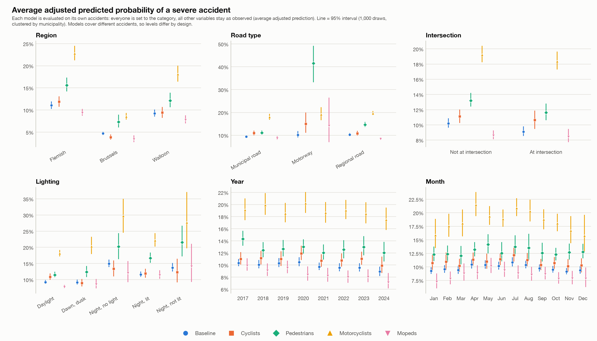

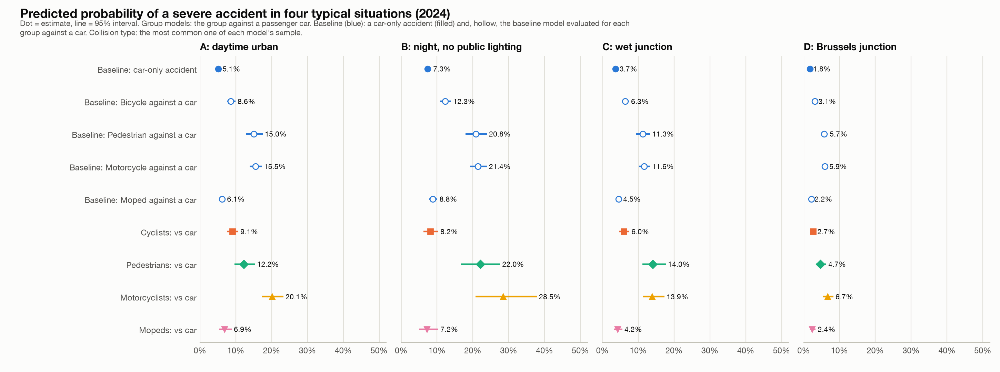

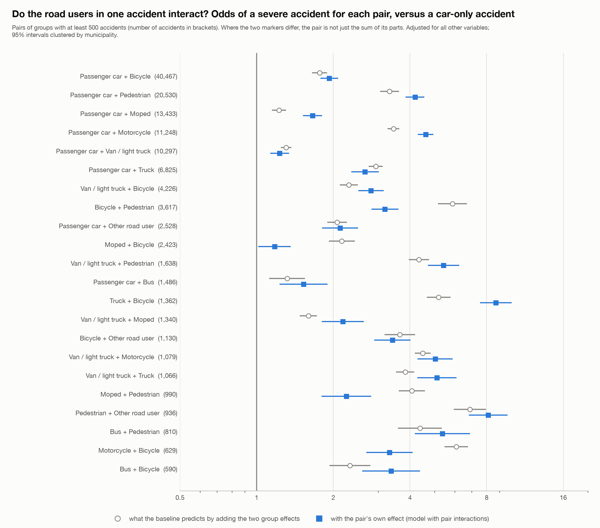

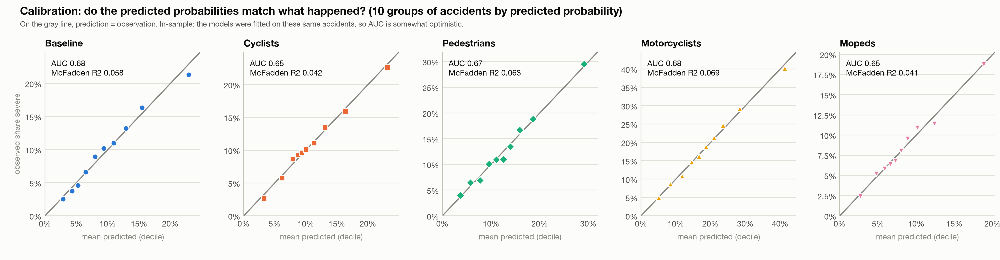

**Limits.** Associations, not causes: speed, traffic, vehicle type and helmet use are not in the data. An accident involving a cyclist and a pedestrian is in both group models. Brussels has fewer accidents in the group models, so its intervals are wider. The models were not tested on other data.

## 6. The interactive tools and how they were checked

**Streamlit tool (`app.py`).** One sidebar for all analyses (period, road users with an overlap switch, region, province and municipality, road type, intersection, lighting, weather and road surface), with the analyses overview and severity, compare groups (crude and adjusted), time, geography and hotspots (with a top 20 of municipalities by number or share for any group), regions and concentration, statistical models (estimated live on the selection, with safeguards: at least 1,000 accidents and 100 severe ones) and the fixed study results (#132-#144). Every number is calculated from the filtered accidents. Exports: the filtered accident data as CSV, tables as CSV or one Excel workbook, charts as PNG or interactive HTML, and a ZIP package with a README that records the filters.

**Checks.** With no filters the tool reproduces the saved results of steps 1 to 3 exactly (severity counts and intervals for all groups, annual counts, seasonal index, the busiest pedestrian square of 82 accidents in Antwerpen, the municipality table). The live models reproduce the saved coefficients, robust standard errors, AUC and AIC of step 5 up to the rounding of the saved files, and the predicted probabilities to 0.0002. The app ran without errors in all analyses and in 18 filter scenarios including one year, one municipality, no groups chosen and a selection too small for a model. A private claude.ai page shows the saved results of steps 1-5, with buttons for group, ranking, period and region in the municipality view, and was tested in headless Chrome (light and dark mode, phone width, strict security policy).

## 7. Limits, open questions and what was not done

- **No rates.** Without traffic, population or exposure figures nothing here says which road user is riskier per kilometre or per person.
- **Missing and unknown information.** About 10-13% of accidents have no coordinates and about 10% have an unknown road user. Unknown weather and road surface have lower severity, which looks like a recording pattern. Missing coordinates are not random (more in Wallonia and before 2022).
- **Not tested.** Whether the Wallonia-Flanders difference between fatal and serious accidents comes from how classes are recorded; why empty coordinates jump in Brussels in 2024; the difference between the classes "with fatalities" and "fatally injured".
- **Not done.** Urban against rural (#55); a mixed model with a random municipality effect (#121); a model of fatal outcomes only (#116: too few events in the group models, for example 133 for mopeds); an out-of-sample test of the models; a second cluster definition such as 500 m squares.
- **Interpretation.** The pre, during and post "Covid-19" periods are my own definition. All results are associations.

## Where to find things

- Decisions and reasons: `beslissingslogboek.md` (#1-#161).
- Code: `scripts/` (steps 8-24), the dashboard in `dashboard_*.py`, the interactive tool in `app.py`, `tool_*.py` and `logit_live.py`.
- Result tables and charts: `reports/`.
- The short version of this report: `reports/findings_summary_steps_1_5.md`.
