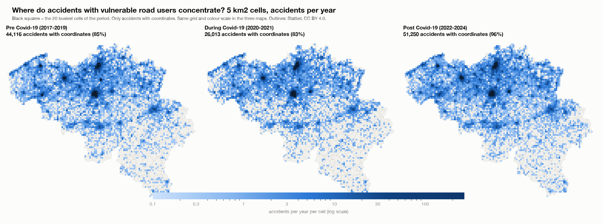
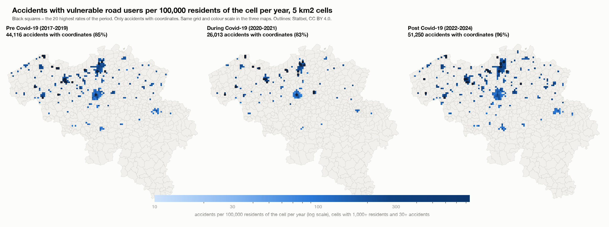
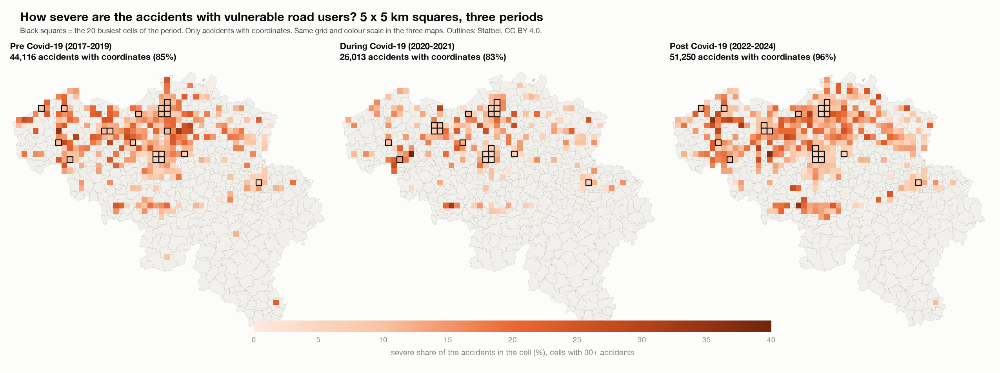
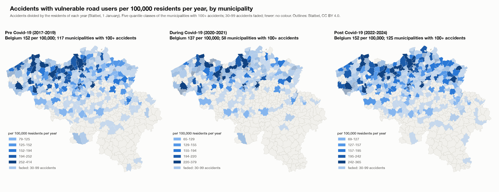

# How the output was calculated: accident hotspots with vulnerable road users, before, during and after Covid-19

Report for the analysis `vulnerable_hotspots/`. It explains, in the order of the calculation, where every number in the Streamlit app, the HTML page and the pictures comes from, **how to read it** (the interpretation), and how each number can be reproduced. The analysis combines step 1, step 2, the municipality top 20 and step 4a of the focused dashboard with the whole hotspot analysis of the folder `hotspot_deep_dive` (hotspots per period on a grid of 5 km2 cells and 5 x 5 km squares, severity at the hotspots, rates per resident). Scripts: `scripts/01` to `scripts/04`. Decisions and their reasons: `beslissingslogboek.md`, entries #169-#192. All numbers in this report are read from the saved tables in `results/` and `data/` by `scripts/04_build_report.py`.

## 1. The question and what was decided

**Question.** Who is involved in accidents (step 1), how severe are the accidents of each road user (step 2), where do accidents with vulnerable road users (pedestrians, cyclists, motorcycles, mopeds) concentrate, did that change before (2017-2019), during (2020-2021) and after (2022-2024) Covid-19 and over all years, how severe are the accidents at the hotspots, and does the picture change when the number of residents is taken into account? Which municipalities and regions stand out?

| Choice | Decision | Entry |
|---|---|---|
| Step 1 | 1a (accidents per road-user group) and 1b (annual change), the same analysis as in the focused dashboard | #181, #187 |
| Step 2 | Severity per road-user group, with the period filter pre / during / post / all years | #189 |
| Grid | Two sizes with a cell-size filter: cells of 5 km2 (side 2,236 m) and squares of 5 km x 5 km, instead of the 500 m squares of the focused dashboard | #170, #188 |
| Hotspots | The 20 busiest cells per group and period; their severity against all other cells; heat maps per group, period and measure | #172, #173 |
| Residents | Accidents per 100,000 residents per year: per municipality (residents of each year) and per grid cell (sector residents of 2023 scaled to each year) | #171, #178, #183 |
| Municipalities | Top 20 by number or share (focused dashboard step 3b/3c) and rates per resident | #189 |
| Regions | Regional severity and the province map (focused dashboard step 4a) | #189 |
| Small numbers | No share under 30 accidents; a rate per cell needs 1,000 residents and 30 accidents; a municipality rate in full colour from 100 accidents, faded and flagged from 30 to 99 | #175, #177, #184 |

## 2. The data

- **Accidents:** the Belgian road accident open data 2017-2024, translated and flagged in the main project: 289,532 accidents, one row per accident. The severity class belongs to the whole accident.
- **Counting rule (#33):** an accident counts for a group if the group is road user 1 or road user 2, once per accident. An accident between a car and a bicycle counts for both groups, so the shares of the groups add up to more than 100% (the groups add up to 425,676 for 289,532 accidents). "All four vulnerable groups" counts an accident that involves two of them once: 136,627 accidents, less than the sum of the four groups.
- **Severity:** *severe* = accident class 1, 2 or 3 (fatal, fatally injured, seriously injured); *fatal* = class 1 or 2; *serious* = class 3; *slight* = class 4 (#116). 28,532 of the 289,532 accidents are severe (9.85%).
- **Coordinates:** the accident file has Belgian Lambert 1972 coordinates (metres). Coordinates outside Belgium's range (two accidents) are treated as missing (#90). Accidents without usable coordinates cannot be put in a grid cell.
- **Periods (#38):** pre 2017-2019 (3 years), during 2020-2021 (2 years), post 2022-2024 (3 years), plus all years (8 years). These names are my own definition; the data states no cause. Because the periods have different lengths, grid counts are divided by the number of years: **accidents per year**.
- **Residents:** Statbel open data (CC BY 4.0): per municipality for each year 2017-2024 (section 9) and per statistical sector for 1 January 2023 (section 6).

### Accidents with usable coordinates

Grid cells use only the accidents that have coordinates. The share without coordinates changes strongly over time, which matters for the comparison of the periods:

| Group | Pre (2017-2019) | During (2020-2021) | Post (2022-2024) |
|---|---|---|---|
| All four vulnerable groups | 51,917 (85.0% with coordinates) | 31,473 (82.7% with coordinates) | 53,237 (96.3% with coordinates) |
| Pedestrians | 12,409 (84.5% with coordinates) | 6,364 (83.5% with coordinates) | 11,124 (95.9% with coordinates) |
| Cyclists | 25,446 (84.9% with coordinates) | 17,265 (82.4% with coordinates) | 29,170 (96.4% with coordinates) |
| Motorcycles | 8,241 (84.2% with coordinates) | 4,375 (80.2% with coordinates) | 7,176 (95.0% with coordinates) |
| Mopeds | 8,689 (86.1% with coordinates) | 5,242 (84.0% with coordinates) | 9,327 (96.8% with coordinates) |

For all four groups together, 15% of the accidents lack coordinates before Covid-19, 17% during it and 3.7% after it. That is why the located accidents per year rise from 14,705 to 17,083 (+16%) while all accidents of the group per year (with or without coordinates) rise only from 17,306 to 17,746 (+2.5%). Grid counts are not corrected for this (#179): a correction would assume that coordinates are missing at random, and they are not (more in Wallonia). The apps and this report say it instead; municipality rates use all accidents.

## 3. Step 1: who is involved, and the annual change (1a, 1b)

**What was calculated.** For every road-user group, the accidents in which the group is involved in 2017-2024 and their share of all 289,532 accidents (1a); and the accidents per year with 2017 = 100, the change of 2020 against 2019, and the change of the average per year in 2022-2024 against 2017-2019 (1b). The numbers come from the summary table `data/dashboard_data.csv` (accidents per group, year and month), calculated in the main project with the counting rule of section 2. "Unknown" and "Other road user" are separate lines.

| Road-user group | Accidents 2017-2024 | % of all accidents | 2020 against 2019 | Index 2024 (2017 = 100) | Post against pre (average per year) |
|---|---|---|---|---|---|
| Passenger car | 203,159 | 70.2% | -25.0% | 82 | -12.2% |
| Bicycle | 71,881 | 24.8% | -5.5% | 115 | +14.6% |
| Unknown | 31,086 | 10.7% | 0.4% | 213 | +65.3% |
| Pedestrian | 29,897 | 10.3% | -30.4% | 86 | -10.4% |
| Van / light truck | 23,557 | 8.1% | -14.8% | 97 | +1.5% |
| Moped | 23,258 | 8.0% | -20.9% | 105 | +7.3% |
| Motorcycle | 19,792 | 6.8% | -18.6% | 83 | -12.9% |
| Truck | 12,595 | 4.4% | -19.9% | 73 | -17.2% |
| Other road user | 6,356 | 2.2% | -26.1% | 127 | +20.9% |
| Bus | 4,095 | 1.4% | -37.7% | 97 | -6.4% |

**How to read it.** The shares add up to more than 100% because one accident can involve two groups. These are counts: a group that is common on the road (cars, bicycles) appears often for that reason alone; severity and traffic volume are not in this step. Nearly every group drops in 2020, the year of the lockdowns; by 2024 bicycles and mopeds are above the level of 2017 and cars, trucks, motorcycles and pedestrians below it. The pre, during and post periods are my own names. "Unknown" more than doubles from 2017 to 2024, so part of the decline of the named groups may be recording that shifts into "Unknown".

## 4. Step 2: the severity per road-user group

**What was calculated.** For each group, the share of the accidents it is involved in that are fatal (class 1+2), seriously injured (class 3) and slightly injured (class 4), with a 95% Wilson interval, for all years and for each period (#74). The class belongs to the whole accident, so a truck-pedestrian accident counts for both groups.

| Road-user group | Accidents | Fatal (class 1+2), 95% interval | Seriously injured (class 3) | Slightly injured (class 4) | Fatal + serious |
|---|---|---|---|---|---|
| All accidents | 289,532 | 1.43% | 8.42% | 90.15% | 9.9% |
| Truck | 12,595 | 5.14% (4.77-5.54) | 12.16% | 82.71% | 17.3% |
| Other road user | 6,356 | 2.94% (2.55-3.39) | 10.76% | 86.30% | 13.7% |
| Motorcycle | 19,792 | 2.76% (2.54-3.00) | 16.18% | 81.06% | 18.9% |
| Pedestrian | 29,897 | 1.96% (1.81-2.12) | 10.82% | 87.22% | 12.8% |
| Bus | 4,095 | 1.64% (1.29-2.07) | 7.33% | 91.04% | 9.0% |
| Van / light truck | 23,557 | 1.51% (1.36-1.68) | 8.47% | 90.02% | 10.0% |
| Passenger car | 203,159 | 1.31% (1.26-1.36) | 7.33% | 91.37% | 8.6% |
| Bicycle | 71,881 | 0.90% (0.84-0.98) | 10.02% | 89.08% | 10.9% |
| Unknown | 31,086 | 0.70% (0.61-0.79) | 6.17% | 93.14% | 6.9% |
| Moped | 23,258 | 0.57% (0.48-0.68) | 7.96% | 91.47% | 8.5% |

**How to read it.** Accidents involving trucks (5.1% fatal) and motorcycles (2.8%) are the most severe, against 1.43% for all accidents; mopeds and bicycles are the least often fatal, but bicycle accidents are more often seriously injured. The shares describe the accidents a group is part of, not the harm to that group's own members, and they are shares given that an accident happened, not the risk of having one. The fatal share of all accidents is 1.54% before Covid-19, 1.47% during it and 1.29% after it. Section 7 shows how severe the accidents are at the hotspots.

## 5. The grid cells and the hotspots

1. **Two grids.** Cells of 5 km2 have a side of sqrt(5) x 1,000 = 2,236.07 m; the squares have sides of 5,000 m. Both are aligned to multiples of the side in Belgian Lambert 1972: the cell of an accident is `(floor(x / side), floor(y / side))`. 5,013 5 km2 cells and 1,274 5 x 5 km squares contain at least one accident of the four groups. The 500 m squares of the focused dashboard are replaced by these two grids (a hotspot of 500 m is a street corner, a hotspot of 5 km is a city district).
2. **Counting.** For each grid, group and period: the accidents with coordinates per cell, the severe, fatal and serious accidents per cell, and accidents per year = accidents / years of the period. The sum over the cells equals the number of located accidents of the group and period (checked in the script).
3. **Hotspots.** The 20 cells with the most accidents (ties: lowest column, then row). The municipality of a hotspot is the most common municipality among its accidents (a cell can cover several municipalities).
4. **Heat maps.** Accidents per year per cell on a **log colour scale** (a few city cells have hundreds of accidents a year, most cells less than one), the rate per resident (section 6) on a log scale, and the severe share per cell on a linear scale from 0 to 40% (cells with 30 or more accidents). In the three-period view the three maps share the same grid and the same colour scale.

The busiest cells for all four groups together (accidents per year):

5 km2 cells:

| Period | 1st | 2nd | 3rd | 4th | 5th |
|---|---|---|---|---|---|
| Pre (2017-2019) | Brussel 264 | Antwerpen 246 | Sint-Gillis 210 | Elsene 176 | Brussel 168 |
| During (2020-2021) | Brussel 252 | Brussel 188 | Antwerpen 188 | Elsene 156 | Brussel 136 |
| Post (2022-2024) | Antwerpen 269 | Brussel 268 | Sint-Gillis 219 | Elsene 158 | Antwerpen 158 |
| All years (2017-2024) | Brussel 262 | Antwerpen 240 | Sint-Gillis 208 | Elsene 164 | Brussel 150 |

5 x 5 km squares:

| Period | 1st | 2nd | 3rd | 4th | 5th |
|---|---|---|---|---|---|
| Pre (2017-2019) | Brussel 634 | Antwerpen 562 | Anderlecht 455 | Elsene 334 | Schaarbeek 325 |
| During (2020-2021) | Brussel 604 | Antwerpen 459 | Brussel 396 | Elsene 288 | Antwerpen 284 |
| Post (2022-2024) | Brussel 656 | Antwerpen 620 | Anderlecht 499 | Antwerpen 386 | Antwerpen 352 |
| All years (2017-2024) | Brussel 635 | Antwerpen 558 | Anderlecht 457 | Antwerpen 328 | Elsene 315 |

**Do the hotspots move?** Number of the 20 busiest cells of the pre period that are still among the 20 busiest of the post period:

| Grid | All four vulnerable groups | Pedestrians | Cyclists | Motorcycles | Mopeds |
|---|---|---|---|---|---|
| 5 km2 cells | 17 of 20 | 18 of 20 | 19 of 20 | 15 of 20 | 12 of 20 |
| 5 x 5 km squares | 18 of 20 | 17 of 20 | 19 of 20 | 16 of 20 | 19 of 20 |

**How to read it.** The hotspots are the big cities (Brussel, Antwerpen, Gent and the Brussels municipalities) and they hardly move between the periods: the pandemic lowered the counts everywhere but did not change where accidents concentrate. A 5 km2 cell shows a city district; a 5 x 5 km square covers a whole city and its surroundings, so there are fewer distinct hotspots and the picture is smoother. Counts per year in the pre and during periods are understated because more coordinates are missing (section 2).

## 6. Accidents per 100,000 residents of a cell

Busy cells are busy because many people live there. To compare cells fairly the accidents are divided by the residents of the cell (decision #183), for both grids.

1. **Residents per sector.** Statbel publishes the residents on 1 January 2023 for each of the 19,795 statistical sectors (`OPENDATA_SECTOREN_2023`), the small areas of the Statbel map of 2023. Statbel adds per municipality one row of residents who cannot be located in a sector (8,046 people, 0.07%); they are spread over the sectors of their municipality in proportion to the sector residents, so that every municipality total stays exact (#185).
2. **From sectors to cells.** Each sector polygon is cut by the grid (the same cells as the accidents) and the residents of the sector are shared over the pieces in proportion to their **area**. This assumes that people are spread evenly inside a sector; sectors are small compared with a 25 km2 square, so the error is small, but a cell that holds a large sector with houses on one side only may be off. A check in the script: the pieces of a sector add up to its area and the cells add up to the Belgian total of 11,697,557.

| Grid | Cells with residents | Cells with 1,000+ residents | Residents of the most populated cell |
|---|---|---|---|
| 5 km2 cells | 6,493 | 2,551 | 86,898 |
| 5 x 5 km squares | 1,368 | 1,082 | 340,044 |

3. **From 2023 to every year.** Statbel's sector files exist only for some years (not for 2017 and 2019) and each follows that year's sector boundaries, so one reference year is used (2023, the year of the sector map). For every year the residents of a piece (cell x municipality) are multiplied by the growth of its municipality: the residents of that year divided by the residents of 2023 (section 9). A check in the script: the residents of all cells, added up over all years, equal the residents of all municipalities added up over all years, for both grids.
4. **The rate.** For a cell, group and period: `accidents / resident-years x 100,000`, where resident-years is the sum over the years of the period of the residents of the cell in that year. It is the average yearly number of accidents per 100,000 residents of the cell.
5. **Small cells (#184).** A rate is shown only for cells with at least 1,000 residents (on average over the period) and at least 30 accidents; otherwise a forest or an industrial cell with a few residents would get an extreme rate. For the rate measure the 20 black cells and the top-20 table are the 20 highest rates among the qualifying cells; for the other measures they are the 20 busiest by number.

Results for all four groups together, 2017-2024:

| Grid | Cells with accidents | Cells that qualify for a rate | Median rate | 20 busiest cells that are also among the 20 highest rates |
|---|---|---|---|---|
| 5 km2 cells | 5,013 | 769 | 153 | 2 |
| 5 x 5 km squares | 1,274 | 594 | 116 | 7 |

The busiest cells are not the highest per resident:

| Busiest cells (all four groups, 2017-2024) | Accidents per year | Average residents | Per 100,000 residents per year |
|---|---|---|---|
| Brussel | 262 | 67,985 | 386 |
| Antwerpen | 240 | 67,904 | 354 |
| Sint-Gillis | 208 | 86,210 | 241 |

| Busiest squares (all four groups, 2017-2024) | Accidents per year | Average residents | Per 100,000 residents per year |
|---|---|---|---|
| Brussel | 635 | 333,386 | 190 |
| Antwerpen | 558 | 180,267 | 310 |
| Anderlecht | 457 | 257,668 | 177 |

The cells with the highest rates (rate per 100,000 residents per year, with the accidents of the period and the average residents):

5 km2 cells:

| Period | 1st | 2nd | 3rd | 4th | 5th |
|---|---|---|---|---|---|
| Pre (2017-2019) | Schoten 788 (46 acc., 1,945 res.) | Antwerpen 661 (82 acc., 4,133 res.) | Lier 524 (30 acc., 1,907 res.) | Knokke-Heist 519 (46 acc., 2,954 res.) | Antwerpen 497 (107 acc., 7,173 res.) |
| During (2020-2021) | Antwerpen 844 (33 acc., 1,954 res.) | Antwerpen 598 (50 acc., 4,181 res.) | Knokke-Heist 509 (30 acc., 2,950 res.) | Knokke-Heist 492 (113 acc., 11,486 res.) | Antwerpen 475 (69 acc., 7,256 res.) |
| Post (2022-2024) | Schoten 832 (49 acc., 1,963 res.) | Wetteren 719 (49 acc., 2,270 res.) | Antwerpen 713 (91 acc., 4,257 res.) | Antwerpen 646 (143 acc., 7,377 res.) | Lier 545 (33 acc., 2,017 res.) |
| All years (2017-2024) | Schoten 819 (128 acc., 1,954 res.) | Antwerpen 665 (223 acc., 4,191 res.) | Wetteren 563 (100 acc., 2,218 res.) | Antwerpen 548 (319 acc., 7,270 res.) | Lier 516 (81 acc., 1,962 res.) |

5 x 5 km squares:

| Period | 1st | 2nd | 3rd | 4th | 5th |
|---|---|---|---|---|---|
| Pre (2017-2019) | Brugge 439 (32 acc., 2,428 res.) | Eeklo 406 (40 acc., 3,282 res.) | Eeklo 377 (197 acc., 17,416 res.) | Knokke-Heist 366 (236 acc., 21,496 res.) | Gent 351 (769 acc., 73,025 res.) |
| During (2020-2021) | Knokke-Heist 446 (51 acc., 5,721 res.) | Leuven 332 (372 acc., 56,067 res.) | Knokke-Heist 312 (134 acc., 21,462 res.) | Ieper 297 (90 acc., 15,145 res.) | Aartselaar 284 (118 acc., 20,763 res.) |
| Post (2022-2024) | Stabroek 836 (54 acc., 2,154 res.) | Brugge 536 (39 acc., 2,424 res.) | Beveren 530 (39 acc., 2,454 res.) | Evergem 474 (84 acc., 5,905 res.) | Knokke-Heist 389 (66 acc., 5,650 res.) |
| All years (2017-2024) | Stabroek 537 (92 acc., 2,142 res.) | Brugge 459 (89 acc., 2,426 res.) | Knokke-Heist 362 (165 acc., 5,698 res.) | Knokke-Heist 349 (596 acc., 21,376 res.) | Gent 341 (2021 acc., 73,995 res.) |

**How to read it.** The busiest cells are in the middle of the big cities, where tens of thousands of people live; the highest rates are in small towns and on through roads (Stabroek, Brugge, Schoten, Knokke-Heist) where fewer residents share many accidents, and in tourist places. A rate per resident is not a rate per kilometre travelled: people who pass through a cell (commuters, visitors) are not residents. A cell rate counts only accidents with coordinates (89% of all), so it is lower than the municipality rate of section 9.

## 7. The severity of the hotspots

Share of the accidents involving vulnerable road users that are severe, in the 20 hotspot cells (the 20 busiest) and in all other cells, with 95% Wilson intervals (all four groups together). A share is only given for 30 or more accidents.

5 km2 cells:

| Period | Accidents in the 20 hotspot cells | Severe % hotspots (95% interval) | Accidents in all other cells | Severe % other cells (95% interval) | Fatal % hotspots / others |
|---|---|---|---|---|---|
| Pre (2017-2019) | 7,824 | 7.3% (6.7-7.9) | 36,292 | 14.1% (13.7-14.5) | 0.45% / 1.68% |
| During (2020-2021) | 4,635 | 5.7% (5.0-6.4) | 21,378 | 13.7% (13.3-14.2) | 0.28% / 1.63% |
| Post (2022-2024) | 8,376 | 6.1% (5.6-6.6) | 42,874 | 12.7% (12.4-13.0) | 0.36% / 1.43% |
| All years (2017-2024) | 20,733 | 6.4% (6.1-6.8) | 100,646 | 13.4% (13.2-13.6) | 0.40% / 1.56% |

5 x 5 km squares:

| Period | Accidents in the 20 hotspot cells | Severe % hotspots (95% interval) | Accidents in all other cells | Severe % other cells (95% interval) | Fatal % hotspots / others |
|---|---|---|---|---|---|
| Pre (2017-2019) | 14,370 | 8.2% (7.8-8.7) | 29,746 | 15.1% (14.7-15.6) | 0.55% / 1.91% |
| During (2020-2021) | 8,341 | 7.2% (6.6-7.7) | 17,672 | 14.7% (14.2-15.2) | 0.44% / 1.83% |
| Post (2022-2024) | 15,602 | 7.2% (6.8-7.6) | 35,648 | 13.6% (13.2-13.9) | 0.45% / 1.60% |
| All years (2017-2024) | 38,228 | 7.6% (7.4-7.9) | 83,151 | 14.3% (14.1-14.6) | 0.47% / 1.77% |

By group (2017-2024):

| Group | Severe %, hotspots / other cells (5 km2 cells) | Severe %, hotspots / other cells (5 x 5 km squares) |
|---|---|---|
| All four vulnerable groups | 6.4% / 13.4% | 7.6% / 14.3% |
| Pedestrians | 7.6% / 14.9% | 8.9% / 16.0% |
| Cyclists | 6.1% / 12.0% | 6.9% / 12.9% |
| Motorcycles | 7.0% / 21.7% | 10.0% / 22.9% |
| Mopeds | 5.5% / 9.2% | 6.0% / 9.7% |

**How to read it.** Accidents in the hotspots are much less often severe than elsewhere, in every period, for every group and for both grids. This is an association: hotspots are cities, where speeds are lower and traffic is slower; speed is not in the data. It also means that the places with the most accidents are not the places with the most severe ones: the severe accidents are spread over roads outside the cities.

## 8. The municipalities: top 20 by number and by share (step 3b/3c of the focused dashboard)

**What was calculated.** For each of the four groups, the accidents involving the group in each of the 581 municipalities, and the group's share of all accidents of the municipality; for 2017-2024, 2022-2024 and each year. The top 20 is ranked by number or by share; a share is only ranked for municipalities with at least 100 accidents of any kind in the chosen period and region (#88, #161), so that a handful of accidents in a village do not top the list. The app and the page re-rank for any period and region.

| Group | Accidents | Top 5 by number | Top 5 by share of the municipality's accidents (100+ accidents) |
|---|---|---|---|
| Pedestrians | 29,897 | Antwerpen 2,687, Brussel 1,637, Gent 1,157, Luik 1,109, Charleroi 809 | Koekelberg 31.5%, Sint-Jans-Molenbeek 30.8%, Jette 30.1%, Sint-Agatha-Berchem 29.9%, Sint-Gillis 29.6% |
| Cyclists | 71,881 | Antwerpen 7,405, Gent 4,229, Brussel 2,478, Leuven 1,773, Brugge 1,598 | Haacht 56.2%, Mortsel 54.4%, Leuven 54.3%, Hove 50.4%, Keerbergen 49.0% |
| Motorcycles | 19,792 | Brussel 1,351, Antwerpen 1,029, Gent 427, Luik 416, Anderlecht 352 | Stoumont 32.7%, Froidchapelle 32.6%, Cerfontaine 29.4%, La Roche-en-Ardenne 28.0%, Bouillon 24.1% |
| Mopeds | 23,258 | Antwerpen 2,250, Gent 1,215, Brugge 610, Brussel 588, Charleroi 444 | Hemiksem 20.3%, Lanaken 18.9%, Schilde 18.2%, Schelle 16.9%, Niel 16.6% |

**How to read it.** By number the big cities win (they have the most accidents of every kind); by share small municipalities can win (for example small Walloon municipalities for motorcycles, with a few dozen accidents each, so a few accidents move the share). These are counts and shares, not rates per resident: section 9 corrects for residents.

## 9. The residents per municipality and the rates per municipality

**Where the residents come from.** Statbel publishes the population of each municipality on 1 January of each year (`TF_SOC_POP_STRUCT_<year>`). The file is one row per age, sex, nationality and marital status; the residents of a municipality are the sum of `MS_POPULATION`. Script `01` downloads the files of 2017-2024 and adds them up.

**The 2019 mergers.** On 1 January 2019 several Flemish municipalities merged and got new NIS codes. The 2017 and 2018 files have 589 old codes, the 2019-2024 files and the accident data have the 581 current codes. The Statbel statistical sectors of 2023 carry both codes (the first five characters of `C_NIS6` are the old municipality, `CNIS5_2023` the current one), which gives an exact table old code -> current code (`data/nis_old_to_2023.csv`); the residents of merged municipalities are added up (#178). After this step every year has 581 municipalities and the total equals the Belgian total of that year:

| Year (1 January) | Residents in Belgium (581 municipalities) |
|---|---|
| 2017 | 11,322,088 |
| 2018 | 11,376,070 |
| 2019 | 11,431,406 |
| 2020 | 11,492,641 |
| 2021 | 11,521,238 |
| 2022 | 11,584,008 |
| 2023 | 11,697,557 |
| 2024 | 11,763,650 |

**The rate.** For a municipality, group and period: `accidents per 100,000 residents per year = accidents / resident-years x 100,000`, where resident-years is the sum over the years of the period of the residents of **that year** (#171). It uses all accidents of the municipality, with or without coordinates.

**Small numbers (#175, #177).** A rate is in full colour and can be ranked from 100 accidents of the group in the period; with 30 to 99 accidents it is shown faded and flagged; under 30 it is not shown. A stricter rule would leave almost nothing for single groups. Municipalities with 100 or more accidents of the group:

| Group | Pre (2017-2019) | During (2020-2021) | Post (2022-2024) | All years (2017-2024) |
|---|---|---|---|---|
| All four vulnerable groups | 117 | 58 | 125 | 302 |
| Pedestrians | 18 | 8 | 15 | 51 |
| Cyclists | 47 | 25 | 60 | 174 |
| Motorcycles | 8 | 3 | 6 | 19 |
| Mopeds | 12 | 6 | 12 | 42 |

Results for all four groups together (rates per 100,000 residents per year; five highest):

| Period | Belgium per 100,000 per year | Municipalities with 100+ accidents | Highest rates (per 100,000 per year) |
|---|---|---|---|
| Pre (2017-2019) | 152.1 | 117 | Brussel 414, Eeklo 410, Wijnegem 397, Knokke-Heist 375, Gent 320 |
| During (2020-2021) | 136.8 | 58 | Knokke-Heist 379, Brussel 369, Leuven 319, Sint-Niklaas 295, Eeklo 294 |
| Post (2022-2024) | 151.9 | 125 | Brussel 365, Knokke-Heist 352, Wommelgem 349, Gent 313, Sint-Niklaas 302 |
| All years (2017-2024) | 148.2 | 302 | Brussel 384, Knokke-Heist 368, Wijnegem 349, Eeklo 321, Wommelgem 306 |

**How to read it.** Counts favour big places. 9 of the 20 municipalities with the most accidents (all four groups, 2017-2024) are also among the 20 with the highest rate. Example:

| Municipality (all four groups, 2017-2024) | Accidents | Average residents | Per 100,000 residents per year |
|---|---|---|---|
| Antwerpen | 12,043 | 530,331 | 283.9 |
| Brussel | 5,716 | 186,177 | 383.8 |
| Knokke-Heist | 969 | 32,953 | 367.6 |

Antwerpen has by far the most accidents (first by number) but a rate below Brussel and Knokke-Heist: it has more residents. After the pandemic the rate per resident is back at the level before it (152 against 152 per 100,000 residents per year; 137 during it), so the rise in counts after 2021 is mostly population growth and better coordinates.

## 10. Regional severity and the province map (step 4a of the focused dashboard)

**What was calculated.** The fatal and the serious share of all accidents in each region and province, with 95% Wilson intervals; the Belgian share is the reference (gray line in the chart). The province map colours the provinces (and Brussels, which has no province) in five classes of the fatal and of the serious share.

| Level | Area | Accidents | Fatal share (95% interval) | Serious share |
|---|---|---|---|---|
| Belgium | Belgium | 289,532 | 1.43% (1.39-1.47) | 8.42% |
| Region | Brussels-Capital Region | 30,022 | 0.42% (0.35-0.50) | 4.45% |
| Region | Flemish Region | 178,348 | 1.23% (1.18-1.28) | 9.67% |
| Region | Walloon Region | 81,162 | 2.26% (2.16-2.36) | 7.16% |
| Province | Antwerp | 53,106 | 1.04% (0.96-1.13) | 9.04% |
| Province | Brussels (no province) | 30,022 | 0.42% (0.35-0.50) | 4.45% |
| Province | East Flanders | 46,193 | 1.07% (0.98-1.17) | 10.47% |
| Province | Flemish Brabant | 23,990 | 1.23% (1.09-1.37) | 8.08% |
| Province | Hainaut | 28,397 | 2.17% (2.01-2.35) | 8.03% |
| Province | Limburg | 21,766 | 1.67% (1.51-1.85) | 8.44% |
| Province | Liège | 25,907 | 1.93% (1.77-2.10) | 6.05% |
| Province | Luxembourg | 7,027 | 3.37% (2.98-3.82) | 10.70% |
| Province | Namur | 11,642 | 2.95% (2.66-3.28) | 6.80% |
| Province | Walloon Brabant | 8,189 | 1.64% (1.38-1.94) | 5.13% |
| Province | West Flanders | 33,293 | 1.44% (1.31-1.57) | 11.50% |

**How to read it.** Wallonia has the highest fatal share (2.26%, against 1.23% in Flanders and 0.42% in Brussels) while Flanders has the highest serious-injury share: that could be real or come from how the classes are recorded, which was not tested. These are shares of accidents, not rates per resident.

## 11. How the pictures, the app and the page are built

- `scripts/03_plot_heatmaps.py` draws `images/*.png` from the saved tables (no recalculation): for each group and grid the heat maps of accidents per year, of the rate per resident and of the severe share, three periods side by side, and the municipality rate maps.
- `charts.py` (hotspots) and `charts_focused.py`, `step1_charts.py` (steps 1, 2, the municipality top 20 and step 4a) build the Plotly charts from the saved tables; `app.py` (Streamlit) shows eight views with filters in one sidebar.
- `build_html.py` packs the saved tables as compact lists in one HTML file (`vulnerable_hotspots.html`); the page draws steps 1, the heat maps, the rate maps and the municipality top 20 in the browser from them, so every combination of buttons works. The severity charts are built in Python and embedded.

## 12. Checks

- The scripts check that the totals equal the main project: 289,532 accidents, 28,532 severe accidents, and 29,897 pedestrian, 71,881 cyclist, 19,792 motorcycle and 23,258 moped accidents.
- For every group, period and grid, the cell counts add up to the accidents with coordinates, and the municipality counts add up to all accidents of the group.
- The residents of every year add up to the Belgian total for 581 municipalities; the sector residents add up to the Belgian total of 1 January 2023; the pieces of a sector add up to its area; the residents of all cells over all years equal the residents of all municipalities over all years, for both grids.
- The Streamlit app was run through every view, group, grid, measure, period and ranking without errors. The HTML page was opened in a browser, every button was used, and the tables on the page equal the saved results (for example Brussel 383.8 and Knokke-Heist 367.6 accidents per 100,000 residents per year for all four groups; Schoten 818.8 per 100,000 residents in the 5 km2 cells of 2017-2024).

## 13. Limits

- **Coordinates:** missing coordinates change over the periods (section 2); grid counts per year are understated before Covid-19. Wallonia has more missing coordinates, so hotspots there may be understated.
- **Residents are not traffic.** Municipalities and cells with visitors, commuters or tourists (Brussel, Knokke-Heist, Gent) get a high rate because many of the people involved do not live there. A rate per resident is not a rate per kilometre travelled.
- **Residents of a cell are an estimate:** sector residents of 2023, spread by area and scaled with the growth of the municipality.
- **Hotspots are where accidents are counted.** A different grid origin or size would give different cells; the two grids show the same big picture.
- **Small municipalities and cells:** a rate or a share moves with a few accidents; this is why minimum numbers are needed.
- **Associations, not causes.** The Covid-19 periods are my own definition; the data states no cause.
